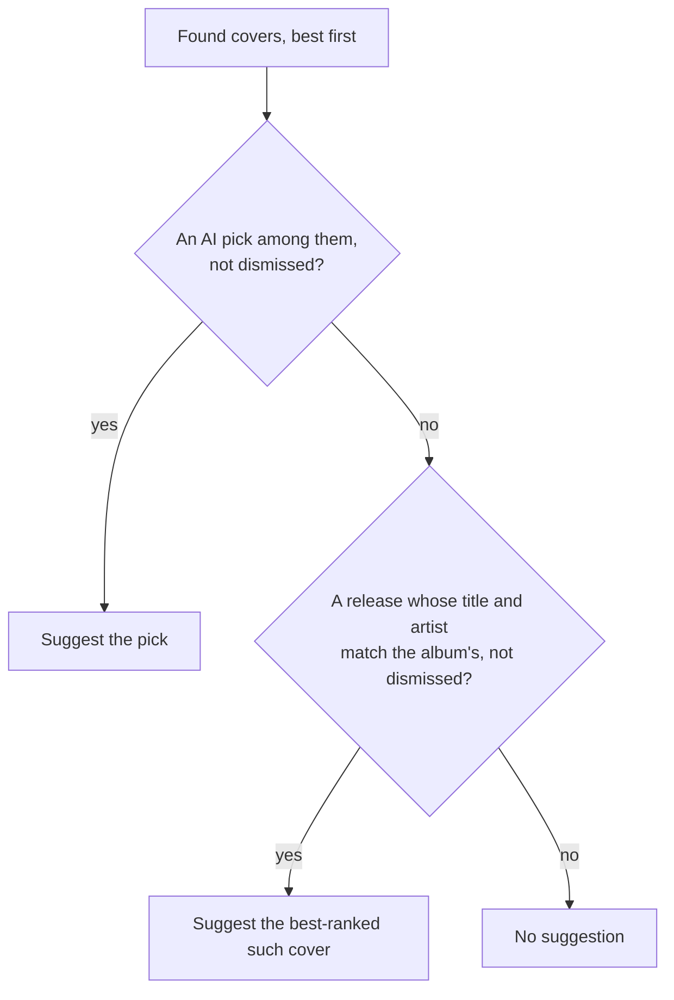

# Album cover suggestions

> [!NOTE]
> **Status: proposed.** This note describes how medleyplay suggests a cover for an
> album that has none, on the album's page and in Clean up, and how the household
> uses or dismisses it in one click. It builds on the album cover search of
> [Track details](Track%20details.md) and mirrors the suggested artist photo of
> [Artists](Artists.md).

## Contents

- [Why](#why)
- [What it delivers](#what-it-delivers)
- [Words](#words)
- [One album, on the page and on the server](#one-album-on-the-page-and-on-the-server)
- [Which cover is suggested](#which-cover-is-suggested)
- [When medleyplay searches](#when-medleyplay-searches)
- [Ready for a second finder](#ready-for-a-second-finder)
- [Using and dismissing](#using-and-dismissing)
- [On the album page](#on-the-album-page)
- [In Clean up](#in-clean-up)
- [Interfaces](#interfaces)
- [Boundary cases](#boundary-cases)
- [Testing](#testing)
- [Built in two steps](#built-in-two-steps)
- [Left out](#left-out)

## Why

An album with no cover shows a placeholder on its tile, its page, its rows, and the
player. medleyplay can already find covers for it: it searches MusicBrainz for the
album's releases, fetches each one's front cover from the Cover Art Archive, and an
AI model can pick among them. But someone has to open the cover editor, wait, and
choose, one album at a time. Artist photos already work the easy way: a likely photo
is found ahead, shown inside the empty photo with *Use*, *Dismiss*, and *Change*, and
listed in Clean up. Albums should work the same.

## What it delivers

- [ ] **A suggested cover for an album without one:** the AI's pick, else the
      best-ranked release whose title and artist match the album's; never one
      dismissed; none rather than a likely wrong one.
- [ ] **Found without anyone searching:** when the album's page opens, and, by a
      Clean up setting, for the albums up next or for every album without a cover,
      paced so it never holds up other MusicBrainz lookups.
- [ ] **On the album page,** the suggestion fills the empty cover with *Use*,
      *Dismiss*, and *Change*.
- [ ] **In Clean up,** *Find album covers* lists the albums without a cover,
      suggested ones first, with *Use*, *Dismiss*, *Change*, and *Use all*.
- [ ] **A dismissed cover stays dismissed** when the album's covers are found again.
- [ ] **The search table is keyed by finder,** so NetEase can add its covers later
      without overwriting MusicBrainz's.

## Words

| Word | Meaning |
| --- | --- |
| **Album** | The songs that write the same album and album artist, else artist, folded as one rule on the page and the server; an empty album name is no album |
| **Album without a cover** | An album none of whose songs shows a cover, from its file, a site, or the household, as its tile decides |
| **Finder** | A site that searches an album's covers: MusicBrainz now, NetEase later |
| **Found covers** | What a finder's last search kept for the album: its releases, best first, each with its front cover |
| **Suggested cover** | The one found cover medleyplay offers to use, or none |

## One album, on the page and on the server

The page groups songs into albums with its `fold` (NFKC, lower case, katakana as
hiragana); the server keys an album's search with `album_key` (NFKC, full case
folding, trimmed). They disagree on kana, on *ß*, and on surrounding spaces, so Clean up could
list an album whose tile shows a cover, or miss one that shows none.

- **One fold.** The server's `album_key` folds as the page does, trimmed on both
  sides, so `アルバム` and `あるばむ` are one album everywhere. Migration 0059 rekeys the
  rows of `album_cover_search` from their stored `album` and `artist`.
- **Each missing album carries its written album and artist,** so the page shows and
  sends them back as written; the server keys them.
- **An album that is one file,** whose songs take their cover from the file, is
  covered through the file, as the album page already does.

## Which cover is suggested

A release **matches** the album when both hold:

- **Its title** equals the album's by `album_keys`: folded, or folded with an edition
  note such as *(Deluxe Edition)* or *(2011 Remaster)* set aside on either side, as
  album ratings already match.
- **Its artist credit** equals one of the album's names, exactly or with one name
  holding the other, as artist matching already allows: its album artist, else
  artist, and every name and alias of the MusicBrainz artists its songs are linked
  to. So *周杰倫* matches an album tagged *Jay Chou* whose songs are linked to him, and
  *A feat. B* matches an album by *A*.

The search already asks MusicBrainz for that title by that artist and drops weak
answers, so this rule rejects only the near misses that would put a wrong cover on
the album in one click. *Change* always opens the editor's grid of every cover found.

Before building, the rule's hit rate is measured on the `album_cover_search` rows the
preview library already holds, offline, against the stricter rule of equal folded
names, and the numbers go into this note.

## When medleyplay searches

A search is one Job in MusicBrainz's lane: one release search, then a front cover for
each release tried, a second apart.

| Trigger | What is searched | Releases tried |
| --- | --- | --- |
| The album's page opens | That album, if never searched, or searched empty over 30 days ago | 12, as the editor |
| *Look again* in the editor | That album | 12 |
| Clean up setting *Up next* (default) | The albums of the song playing and the next | 4 |
| Clean up setting *Every missing* | Every album without a cover, never searched or empty for 30 days, those up next first | 4 |
| *Find all* in Clean up | Every album listed, whatever the setting | 4 |
| Setting *Off* | Nothing in the background; the page and the editor still search | — |

- **Opening the page counts as asking,** as an artist's page does for photos. *Off*
  stops only the look-ahead and the background search.
- **The background never holds up a lookup.** A background search is queued only while
  MusicBrainz's lane is otherwise empty: a scan's lookups, a page opened, or the
  editor go first. Each search queues the next when it ends. Four releases make a
  background search about 6–10 s, so 400 albums take about an hour of idle time
  instead of two to four hours of a blocked lane.
- **The albums about to play go first.** Only the page knows the play queue, so under
  *Every missing* the look-ahead sends the next 50 songs of the queue each time the
  song changes. The server keeps the latest list in memory, and each background search
  takes the first album in it not yet searched, then the rest by song count, most
  first. A restart forgets the list until the next song starts.
- **An AI pick is asked in the background only when it helps:** after a search, when
  no release matches, two or more covers were found, an AI model is set up, and the
  household turned on *Pick album covers by AI* in Clean up. It is off by default,
  since each pick is an AI call and a library may hold hundreds of albums. It is a Job of the AI's
  lane, like any pick. The editor keeps asking when opened, as it does today.
- **Found covers nobody needs are let go.** Once an album has a cover, or leaves the
  Library, its found covers are removed and their files swept, keeping the one used.

The settings are two new household settings beside `find_artist_photos`:
`find_album_covers` (*Off*, *Up next*, *Every missing*; default *Up next*) and
`pick_album_covers_by_ai` (default off).

## Ready for a second finder

NetEase is the planned second finder, for Chinese albums. Today one search row per
album holds MusicBrainz's covers, and a new search replaces the row, so a second
finder would overwrite the first. Migration 0059 makes the key `(key, finder)`, with
`finder` `musicbrainz` for the rows there are, and the Job target names the finder.
The dismissed covers move to their own table, `album_cover_dismissal (key, cover)`,
since a cover is named by its bytes whichever finder found it. Widening `CoverOption`
past MusicBrainz release ids is left to the NetEase note.

## Using and dismissing

- **Use** goes to the server, `POST /api/album-covers/use`, with the album as written
  and the cover. In one transaction it checks the album still has no cover, then sets
  the household cover on each song that shows none, or on the file of an album that is
  one file. A song that gained its own cover meanwhile keeps it.
- **Use all** in Clean up does the same for every suggested album listed.
- **Dismiss** adds the cover to the album's dismissed covers; the next suggestion, if
  any, takes its place.

## On the album page

The album page already shows its cover with *Save* and *Replace* on hover. With no
cover, the empty cover shows, in turn:

- **Looking on MusicBrainz…** while a search runs, or *waits until Online*.
- **The suggested cover,** marked as a suggestion, with *Use* (the lower half, green),
  *Dismiss* (top right, red), and *Change* (top left), the zones a suggested artist
  photo has. *Change* opens the cover editor on the MusicBrainz tab.
- **Nothing more** when no cover is suggested: clicking the cover opens the editor, as
  today.

`SuggestedCover` is new, beside `SuggestedPhoto`; both use `SuggestedFrame`, which
gains a noun, so a screen reader hears *Suggested cover of …* and *Use this cover*.

## In Clean up

*Find album covers* joins *Find artist photos*, laid out the same way:

- The settings, *Find all*, and *Use all*.
- Each album without a cover: its name and artist, how many songs it has, and its
  suggested cover with *Use*, *Dismiss*, and *Change*; suggested albums first, then by
  song count. An album searched with no suggestion says so, with *Change*.
- When *Use* or *Dismiss* removes a row, focus moves to the next row's first control.
- The count of albums with a suggestion joins Clean up's count on the rail.

The look-ahead that asks for artist photos of the songs up next asks for their album
covers in the same pass.

## Interfaces

| Type | Where | Change |
| --- | --- | --- |
| `album_key` | `application/album_covers.py` | Folds as the page's `fold` does, trimmed |
| `album_cover_search` key `(key, finder)` | `persistence/schema.py`, migration 0059 | Rekeyed rows; `finder` named |
| `album_cover_dismissal` | `persistence/schema.py`, migration 0059 | New: `(key, cover)` |
| `CoverSearch`, `Settings.find_album_covers`, `Settings.pick_album_covers_by_ai` | `domain/settings.py` | New |
| `FindCovers.tried` | `plugin_api/album_covers.py` | New: how many releases to try, 12 by default |
| `suggested_cover(found, pick, dismissed, names)` | `domain/covers.py` | New: the rule above, pure |
| `AlbumCoverService.missing()` | `application/album_covers.py` | New: grouped in SQL on the written album and artist, folded and merged in Python; searches read with one `IN`, and finding from the active Job targets |
| `AlbumCoverService.find_missing(caller, track_ids, every)` | `application/album_covers.py` | New: queues background searches, paced |
| `AlbumCoverService.use(caller, album, artist, cover)`, `.dismiss(...)` | `application/album_covers.py` | New |
| `AlbumCovers.suggested` | `application/album_covers.py` | New field, for the page and the editor |
| `GET /api/album-covers/missing` | `web/album_covers.py` | New, cached per revision |
| `POST /api/album-covers/missing/find`, `/use`, `/dismiss` | `web/album_covers.py` | New; `POST /api/album-covers/find` stays the editor's |
| `SuggestedCover`, `SuggestedFrame`'s noun | `web/src/views/` | New, and a prop |
| `FindAlbumCovers` | `web/src/views/FindAlbumCovers.tsx` | New Clean up section |
| The look-ahead | `web/src/library/usePhotoLookAhead.ts` | Asks for album covers too; under *Every missing* sends the next 50 songs of the queue |

## Boundary cases

| Case | Behavior |
| --- | --- |
| MusicBrainz is off | No search; the page and Clean up say MusicBrainz must be on to find covers |
| Offline | Searches wait, as any MusicBrainz Job does; the page says it waits |
| The album gains a cover another way | It leaves the list; its found covers are let go |
| A song gains its own cover after the list was read | *Use* leaves that song's cover alone |
| Every found cover dismissed | No suggestion; *Change* still opens the editor |
| A search finds nothing | Searched again after 30 days, or by *Find all* or *Look again* |
| An album name under two or more artists, with no album artist, as a compilation | Each is its own album, as on the page; the background skips them, since the search per artist rarely finds the compilation; the page and the editor still search |
| An empty album name | No album: never listed or searched |
| Found covers replaced by a new search | The pick stands only if the releases are the same; dismissed covers stay |
| Two triggers for one album at once | One Job: a search for the album and finder already queued isn't queued again |

## Testing

- **`suggested_cover`:** the pick first; else the best-ranked match; an edition note on
  either side still matches; an alias of a linked artist matches; a near miss suggests
  nothing; dismissed covers are skipped, the pick included.
- **`album_key`:** agrees with the page's `fold` on kana, case, and spaces; the
  migration rekeys rows so a search kept before is still found.
- **`AlbumCoverService`:** `missing()` lists albums without a cover, suggested first,
  leaving out albums with a file's cover, empty names, and compilations from the
  background; `find_missing` queues only while the lane is otherwise empty, the next
  when one ends, none while MusicBrainz is off; `use` sets songs without a cover, or the
  file, and skips a song that has one; `dismiss` survives a new search; found covers
  are let go once the album has a cover.
- **Routes:** each new route for any signed-in Account, as the artist-photo routes are;
  the missing list answers 304 when unchanged.
- **Web:** the album page shows looking, then the suggestion with its three controls;
  *Use* calls the server and the tile shows the cover; Clean up lists, uses, dismisses,
  uses all, finds all, and moves focus on; the look-ahead asks for both.
- **End to end:** an album without a cover, its covers found by the fake finder, shows
  the suggested cover on its page and in Clean up, and *Use* puts it on its tile.
- Tests never contact MusicBrainz, the Cover Art Archive, or an AI provider: the
  existing fakes answer.

## Built in two steps

1. **The server and the album page:** the one fold and migration 0059, the rule, the
   page-open search, `use` and `dismiss`, and the suggestion on the page.
2. **Clean up and the background:** `missing()`, the settings, the paced background
   search with its AI pick, the Clean up section, and the look-ahead.

Each is its own pull request, with the measurements in the first.

## Left out

- **NetEase covers.** Planned next, as its own note: a second finder whose covers join
  the found covers. This note makes the table ready for it.
- **Covers for songs added to an album later.** The album's tile already shows a
  cover, so it never returns to the list; such a song keeps the placeholder in its own
  row until someone sets the album's cover again.
