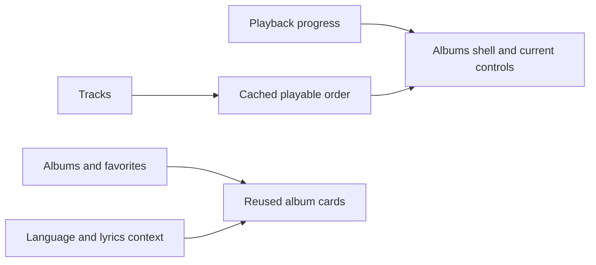

# Browser responsiveness

> [!NOTE]
> **Implemented.** The Albums gallery skips
> offscreen rendering and reuses unchanged cards during playback,
> keeping its complete list and existing controls.
> Artists and the first Library load are unchanged.

## Contents

- [Scope](#scope)
- [Album rendering](#album-rendering)
- [Measured improvement](#measured-improvement)
- [Validation and limits](#validation-and-limits)
- [Crosscheck](#crosscheck)
- [Album contents during playback](#album-contents-during-playback)
- [Further investigations](#further-investigations)
- [References](#references)

## Scope

Reduce unnecessary layout, painting, and repeated card rendering in Albums.
Keep every album in the DOM, in the same order, with the same links,
counts, favorites, and playback actions. Do not paginate the catalog,
change its API, or introduce a rendering dependency.

[First Library load](First%20Library%20load.md) owns the startup sequence.
[Web client](Web%20client.md#search) owns search behavior.
The [No blank frames](No%20blank%20frames.md) note owns loading feedback.
Those behaviors are not changed by this component.

## Album rendering

The Albums view opts its shared list component into deferred rendering.
Search-result album lists do not opt in. Artists, artist-name choosers,
Playlists, Radio, and the virtualized Songs table retain their rendering.
The opt-in uses a CSS class, not translated labels.

Each album's list item supplies an inline-size container. Its link uses
`content-visibility: auto`, so the browser can skip offscreen descendants
while keeping the link available to keyboard navigation and browser
search. The link owns its hover shadow and focus outline. Applying paint
containment to its outer list item would risk clipping those effects.
The favorite badge and cover ring remain inside the link's padding.

The reserved content height follows the existing card geometry:

```text
square cover width = list-item width - twice the link padding
content height = square cover + cover margin + title line
                 + metadata line + two grid gaps
```

Container-query units supply the current width; the existing padding,
spacing, metadata font size, and line height supply the remaining
dimensions. Shared CSS variables keep those values consistent with the
rendered card. There is no fixed desktop height, JavaScript measurement
loop, or item-count threshold.

An `@supports` rule leaves the original rendering in place when the
required CSS is unavailable. Containment changes rendering work, not
which records exist or which albums Play and Shuffle consider.

## Measured improvement

The final comparison uses production baseline and candidate builds,
Chrome 158 on an Intel Core i9 Mac, a 1280 by 800 viewport, native CPU
speed, 60 ms simulated network latency, and 1,048,576 bytes per second.
Both builds use the same disposable synthetic database. No measurement
uses the household server or its credentials.

Each sample opens a fresh browser context, loads Library, allows the
initial secondary work to settle, and then clicks Albums. The measurement
runs from the click event to the first album link and subsequent animation
frames. It is a lab view-readiness measurement, not field INP or an exact
paint timestamp. The harness verifies the candidate's computed containment
style and equal album counts before accepting a sample.

Seven adjacent pairs per catalog alternate baseline and candidate order.
The table reports separate medians and the median saving within each pair;
those two ways of summarizing the data need not subtract to the same value.

| Synthetic tracks | Album cards | Baseline median | Candidate median | Paired saving | Paired reduction | Improved pairs |
| --- | ---: | ---: | ---: | ---: | ---: | ---: |
| 1,906 | 890 | 1,081 ms | 838 ms | 205 ms | 19.8% | 7/7 |
| 7,000 | 3,267 | 4,877 ms | 3,335 ms | 1,543 ms | 31.6% | 7/7 |

Paired savings range from 81 to 1,534 ms in the smaller fixture,
and from 283 to 3,998 ms in the larger fixture.
Measured browser layout work falls by a paired median 220 ms and 1,142 ms,
respectively. Layout savings are not equal to end-to-end savings.
The shared machine still varies in load; these figures are comparative
lab results, not guarantees for every device.

The rendering experiment for Artists did not justify retaining it.
At 1,906 tracks it regressed by a paired median 43 ms; at 7,000 tracks
the paired improvement was only 13 ms and two pairs regressed. Artists
therefore keeps its existing rendering rather than gaining an arbitrary
size threshold.

**No first-Library-load improvement is claimed.** Measurements of
Artists-to-Albums navigation with both galleries changed do not isolate
Albums rendering and are not used as the final result.

## Validation and limits

The browser regressions exercise the real production build with synthetic
catalog responses. They verify that offscreen album content is skipped,
every link remains present, scrolling reaches the last album, and clicking
it opens the correct page. They also cover unchanged Artists and search
galleries, favorites, keyboard focus, and phone-width navigation.

Responsive checks resize from desktop to phone and back with normal and
enlarged text. They compare the contained layout with the same DOM using
ordinary rendering: the first card stays within 0.05 CSS pixels, the last
within 0.1, and the complete test grid within 4. These tolerances account
for accumulated fractional layout rounding, not missing cards.

Separate captures compare a favorite album with a cover image in light
and dark themes, hovered and keyboard-focused. The phone-width captures
are pixel-identical. Desktop captures have minor heart antialiasing and
roughly one pixel of lower focus-edge rounding; strict zero-difference
comparisons are not identical. Independent visual review finds the focus
outline intact and no material clipping or layout change.

The checks use installed Chrome rather than a newly downloaded browser.
They are not measurements from physical phones or other browser engines.

## Crosscheck

- [x] Keep the complete Albums list and whole-catalog playback actions.
- [x] Skip offscreen album rendering without changing first-card layout.
- [x] Preserve keyboard focus, hover feedback, favorites, and navigation.
- [x] Exercise resizing and enlarged text without a fixed card-height guess.
- [x] Leave Artists, search galleries, Playlists, Radio, and Songs unchanged.
- [x] Compare the retained production implementation at both catalog sizes.
- [x] Obtain independent implementation and visual reviews.

**Achieved:** Albums renders less offscreen content and opens faster in the
paired comparisons, with its controls and list intact.

**Changed:** Only Albums uses containment. The candidate for Artists does not
meet the requirement to retain demonstrated latency gains.

**Outside offscreen rendering:** First-Library startup and playback-update
rendering are separate concerns.

## Album contents during playback

> [!NOTE]
> **Implemented.** Reuse unchanged album cards while keeping
> playback controls and changing Library data current.

### Playback measurements

Foreground Chrome compares baseline and candidate production builds on a
loopback server. Each fresh browser context plays local silent WAV audio
with two Up next entries. Only the local-file plugin is enabled; neither
household data nor outside sites are used. Both builds keep all album cards
and the existing offscreen containment.

There are seven adjacent pairs per fixture, alternating which build runs
first, at 1280 by 800 with no artificial CPU slowdown. Three-second windows
are normalized by their recorded elapsed time, which ranges from 3.002 to
3.020 seconds. Each sample then presses Enter on **Volume down** three times
and verifies both the audio volume and its displayed value. Event Timing
measures each `keydown` through its next paint; the sample contributes the
median of those three interactions.

| Album cards (tracks) | Measure | Baseline median | Candidate median | Median paired saving |
| --- | --- | ---: | ---: | ---: |
| 890 (1,906) | Scripting per elapsed second | 678 ms | 43 ms | 635 ms (93.8%) |
| 890 (1,906) | Keydown to next paint | 336 ms | 168 ms | 176 ms (51.2%) |
| 98 (210) | Scripting per elapsed second | 170 ms | 62 ms | 103 ms (62.6%) |
| 98 (210) | Keydown to next paint | 128 ms | 96 ms | 32 ms (25.0%) |

Columns are medians across samples; paired savings and percentages are
medians of differences within each pair. Scripting improves in every pair.
The large gallery's interaction measure improves in every pair; the small
gallery improves in five pairs and ties in two. Playback keeps advancing,
with 11–12 progress events per window and every expected card still present.
Profiles shift from repeated `AlbumList`, `KindMark`, and playable-order
work to small header and navigation work.

Both fixtures are album-dense. A Library with fewer album cards for the same
number of tracks may see a different saving. This is a busy, shared Mac:
its one-minute load average ranges from 7.2 to 30.9 during large-gallery pairs and 15.6 to
85.1 during small-gallery pairs. These are comparative lab results, not
quiet-machine estimates or field INP.

Not every metric improves. Layout costs a paired median 3.3 ms more per
elapsed second for the large gallery and 2.2 ms more for the small one.
Paused Library-to-Albums navigation, measured by a DOM and following-frame
proxy, has mixed results: paired medians are 3 ms later and 16 ms sooner,
respectively. That proxy is not a paint timestamp. Three paired Library
and Artists controls per fixture also vary; no gain is attributed to this
change in those views.

The worst of the three small-gallery key responses is slower in three
pairs, by up to 128 ms. The samples therefore do not establish improved
tail latency or prove the absence of regressions. **No startup or initial
gallery-mount improvement is claimed.**

### Rendering boundary

The implementation stays local to `Views.tsx`:

| Part | Implementation | What stays live |
| --- | --- | --- |
| `AlbumList` | The shared card list uses React `memo` with its default comparison. | Changed albums, favorites, language, and lyrics context. |
| `Albums` | The filtered, sorted `playable` array uses `useMemo` on `tracks`. | The existing Play/Shuffle callbacks and their current playable order. |

The list already receives only album data, favorites, and the offscreen
rendering flag. Its inputs come from existing cached derivations.
There are no action callbacks to stabilize or ignore in a comparison.
The Albums shell continues rendering its current controls.



Language is read inside the list, and lyrics inside its marks. Their
subscriptions continue updating through `memo`. Metadata and favorite
updates replace their input data rather than mutating it. Changes to the
current or next track may still rebuild the derived album list; removing
that occasional work is outside this component.

Every card and the existing CSS containment stay in place. There is no
virtualization, pagination, translated-string cache, whole-`CurrentView`
cache, or player state ownership change. `ArtistList` is unchanged.

### Playback validation

- [x] Preserve mounted-card updates for favorites, titles, artist names,
      covers, language, and complete/incomplete album lyrics.
- [x] Check lyrics-context updates with unchanged album-list props.
- [x] Preserve artist filtering and changing or clearing search queries;
      search also uses the shared album list.
- [x] Keep Play and Shuffle bound to current actions and playable tracks,
      including availability changes and an empty playable set.
- [x] Preserve complete card counts, links, keyboard focus, and responsive
      layout in light/dark and desktop/phone views.
- [x] Compare baseline and candidate in seven alternating pairs for large
      and small galleries, recording actual card counts and host load.
- [x] Measure scripting and foreground input-to-next-paint during real silent
      playback. Treat DOM/frame readiness as a proxy, not a paint timestamp.
- [x] Check navigation and the unchanged Library/Artists views for regressions.
- [x] Verify the candidate profile removes repeated card work, rather than
      hiding cards or reducing playback updates.
- [x] Obtain independent implementation review and retain only demonstrated
      benefit; do not add timing thresholds to required unit tests.

The existing component and browser suites check behavior, not private
render-call counts. Favorites-only changes update retained cards, and
lyrics context updates pass through unchanged view props without exporting
the private list for tests. Desktop and phone hover/focus captures in both
themes show no pixels differing by more than 10 channel levels. This adds
no dependency or required CI category.

## Further investigations

Investigate browser work between the track response and the first playable
song before assuming bundle size is the largest startup opportunity.
Existing unfinished bundle work must not be overwritten.

Artist suggestions use selected search groups; the behavior and measurements
belong to [Web client](Web%20client.md#selective-search-computation). Unchanged queue contents are
handled by [Playback](Playback.md#queue-rendering-during-playback).

Further playback and scrolling work needs its own profile before adding
caches or changing state ownership. Preserve current values and callbacks.
Keep the startup event stream connected: delaying subscription can miss
catalog changes between the initial read and subscription.

Pagination is a separate architectural decision. Search, sorting,
grouping, counts, and Play all must continue to operate on the whole
catalog, not just the visible window.

## References

- [CSS content visibility](https://developer.mozilla.org/en-US/docs/Web/CSS/Reference/Properties/content-visibility):
  `auto` preserves find-in-page and keyboard focus, unlike `hidden`.
- [Intrinsic block size](https://developer.mozilla.org/en-US/docs/Web/CSS/Reference/Properties/contain-intrinsic-block-size):
  reserve space while content is skipped.
- [CSS containment](https://developer.mozilla.org/en-US/docs/Web/CSS/Reference/Properties/contain):
  paint containment clips descendants outside its boundary.
- [Optimize long tasks](https://web.dev/articles/optimize-long-tasks):
  splitting functions alone does not yield the browser's main thread.
- [Code-split JavaScript](https://web.dev/learn/performance/code-split-javascript):
  measure both startup and first-use latency.
- [React memo](https://react.dev/reference/react/memo):
  unchanged props are required to reuse a rendered result.
