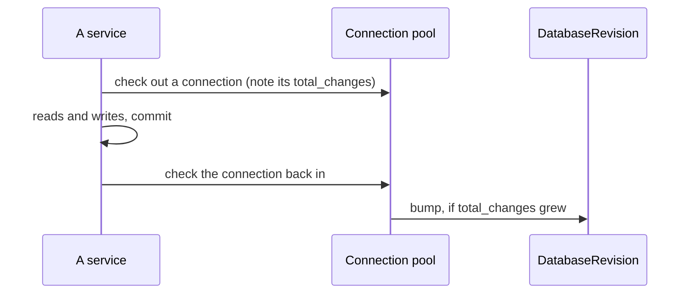
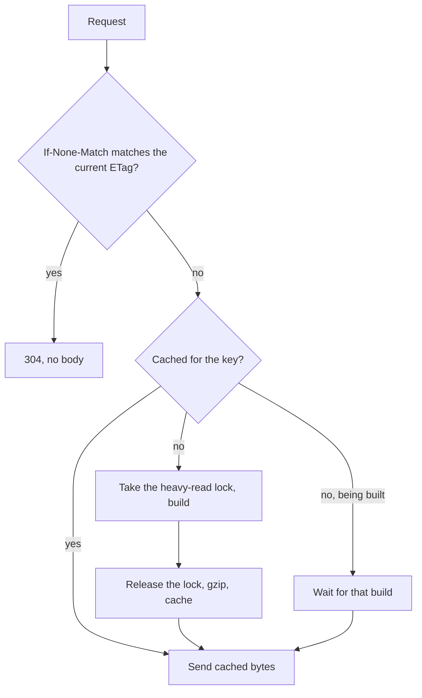

# Cached reads

> [!NOTE]
> **Status: implemented.** This note describes how the server answers its largest
> reads, the songs and the artist names, from a cache that a database revision
> keeps true, says "not changed" when a browser already holds the answer, and runs
> the reads that build an answer one at a time. Making the web client ask less
> often is a separate step that builds on this one.

## Contents

- [Why](#why)
- [What it delivers](#what-it-delivers)
- [Cheaper builds first](#cheaper-builds-first)
- [The database revision](#the-database-revision)
- [Cached answers](#cached-answers)
- [Heavy reads, one at a time](#heavy-reads-one-at-a-time)
- [Interfaces](#interfaces)
- [Boundary cases](#boundary-cases)
- [Testing](#testing)
- [Measured](#measured)
- [Open questions](#open-questions)

## Why

The answers that fill the Library are built afresh on every request. The songs,
for example, take about 0.18 s of Python: ten reads of whole tables, then 1738
answers to build and turn into 1.2 MB of JSON. One such read is quick. Many at
once are not: SQLite releases Python's global interpreter lock on every row it
fetches, so threads that build answers side by side keep handing the lock back and
forth. Five song lists built at once take 3.2 s, against 0.96 s one after another.
A page load asks for about fifteen reads at once, so its last answer comes after
6.3 s instead of about 1.2 s.

Most of this work rebuilds an answer that has not changed. The fix is to build each
answer cheaply, once per change, and never let two heavy builds fight.

## What it delivers

- [x] **Cheaper builds:** the artist names ask for the active Jobs once, not once
      per name, and the songs are serialized once, not twice.
- [x] A **database revision** that changes whenever a write changes rows, whichever
      service makes it, and never for a write that changes none.
- [x] **Cached answers** for `GET /api/tracks` and `GET /api/artist-names`: built
      once per revision, kept as JSON bytes and as gzip bytes, and sent as they are.
- [x] An **ETag** on each cached answer, and **304 Not Modified** when a request's
      `If-None-Match` holds it, without building anything.
- [x] **gzip** for a cached answer when the request accepts it.
- [x] **Heavy reads, one at a time:** every read listed in
      [Heavy reads](#heavy-reads-one-at-a-time) builds its answer only while it
      holds one lock.
- [x] **Signing out clears the browser's cache** of these private answers.
- [x] Before-and-after measurements in the pull request.

Browsers already send `If-None-Match` for an answer they hold, so 304s start with
no change to the web client. The client cannot see a 304 through `fetch`, though:
letting it skip parsing and re-rendering an unchanged answer is the client step,
along with keeping unchanged songs, cover thumbnails, and fallbacks while code
loads.

## Cheaper builds first

Two builds do needless work, which caching alone would only hide:

- **The artist names ask for Jobs once per name.** `ArtistService.names` asked,
  for each name, whether a MusicBrainz or Wikidata Job is active, and
  `recommending` once per batch; each asking opened its own session and query.
  `JobService.active_targets(kind)` reads the targets of a kind's active Jobs in
  one query, and answers them all. The artists missing a photo ask it the same way.
- **The songs are validated twice.** The route built `TrackOut` models, then
  FastAPI validated and serialized them again for the `response_model`. A cached
  answer serializes the list once, with a `TypeAdapter` and `by_alias` as FastAPI
  does, so the bytes are the same for less work.
- **The track list shares its source read.** The catalog reads only the source
  columns it needs for availability, downloads, and video links. A split song
  can use its album file's source from that same read instead of fetching it
  again. Source order and the response bytes do not change.

Each change is measured on its own, so the pull request shows what it bought.

## The database revision

The server is the only process that writes the database
([Architecture](Architecture.md#processes)); Jobs return results and the server
applies them. So the server can notice every change itself.



- **Counted by rows changed.** SQLite counts, per connection, every row inserted,
  updated, or deleted (`total_changes`). The pool notes the count when it hands a
  connection out and compares when it takes it back; the revision changes only if
  rows did. So the Job runner's update of waiting Jobs, which runs every second and
  usually changes nothing, leaves the revision alone, and every way of writing
  counts: ORM, Core, `text()`, insert-or-update, and batches.
- **Bumped once, after the commit.** A Session returns its connection when its
  transaction ends, after the commit is visible. An answer is labeled with the
  revision read *before* its build, so an answer that missed a commit carries a
  revision that is already gone and the next request rebuilds. Reads take no
  snapshot (the driver reads outside a transaction), so the ten reads of one build
  may see different moments; the same rule makes that safe.
- **An invalidated connection bumps.** Its count can't be read, so the revision
  changes anyway.
- **A boot mark.** The revision starts at zero with each server start, so the ETag
  also holds a random mark chosen at start. An ETag from before a restart never
  matches.
- **The rule it relies on:** no code holds a connection across a commit. Only the
  migration does, and it runs before the server serves.

## Cached answers

A cached answer is keyed by what the answer depends on, and holds the bytes the
server sends.

| Read | Key | Depends on beyond the database |
| --- | --- | --- |
| `GET /api/tracks` | revision, Account, Online | The Account's own state; whether the Mode is Online, which decides what can play |
| `GET /api/artist-names` | revision | Nothing |



- **Built under the revision read before the build,** so an answer is never
  labeled newer than the rows it holds. Online is read once, before the build too,
  with `CatalogService.online()`, and handed to `list_tracks(…, online=…)`, so the
  key and the answer agree even if the Mode changes meanwhile.
- **Bytes, not models.** The answer is serialized once, under the lock, then sent
  as a `Response` with its bytes, so a cache hit does no Python work beyond the
  lookup. It is also gzipped at level 6, outside the lock, and sent with `Content-Encoding: gzip`
  when the request's `Accept-Encoding` allows it.
- **Headers,** on a 200 and a 304 alike: `ETag`, `Cache-Control: private,
  no-cache` (a browser may keep it, but asks each time), and `Vary:
  Accept-Encoding`.
- **The ETag names the key:** the boot mark, the revision, the Account, and
  Online, hashed into one weak tag that both encodings share. Two Accounts on one
  browser never share a 304.
- **One answer per place:** one entry per read, Account, and Online, replaced
  when a newer revision is built. An older revision's answer is never needed
  again, so nothing older is kept.
- **Concurrent misses build once.** A request that misses registers its build
  before it takes the lock; a second request for the same key waits on that build,
  outside the lock, and sends the same bytes.
- **Signing out** answers with `Clear-Site-Data: "cache"`, so a shared browser
  keeps no songs of the Account that left.

## Heavy reads, one at a time

A **heavy read** is a read whose answer takes Python more than about 50 ms to
build at this library's size. Each one builds only while it holds one
process-wide lock, so builds take turns instead of slowing each other down.

| Read | Alone |
| --- | --- |
| `GET /api/tracks` (a cache miss) | 0.18 s |
| `GET /api/artist-names` (a cache miss) | 0.19 s |
| `GET /api/artist-photos/missing` | 0.17 s |
| `GET /api/enrichers/{key}` | 0.05–0.15 s |
| `GET /api/shared-names` | 0.13 s |

- **Light reads and writes never wait for it.** The Mode, the Account, Playlists,
  covers, and audio don't take the lock; nor do a 304 and a cache hit.
- **A heavy build never writes,** so it never waits on SQLite's write lock while
  holding this one; tests check that the revision is unchanged across each.
- **Taking it twice raises.** A heavy build that calls another heavy build fails
  at once rather than waiting on itself.
- **No order is promised.** A waiting read waits for the build under way and may
  be passed by a later one; each build is under a third of a second at this size.

Rejected alternatives:

- A smaller thread pool for every request would make audio and light reads wait
  behind heavy ones.
- A process pool would serialize every answer across processes, adding cost
  rather than saving it at this size.
- Caching every heavy read is not needed yet: the enricher reads depend on the
  clock ("asked in the last 24 hours"), so a revision alone can't keep them true.

## Interfaces

| Type | Where | Responsibility |
| --- | --- | --- |
| `DatabaseRevision` | `persistence/revision.py` | The revision and the boot mark; `watch(engine)` registers the pool events that bump it |
| `CachedAnswers` | `web/cached.py` | One answer per key, built once, kept as JSON and gzip bytes; answers a request with 304, cached bytes, or a fresh build |
| `heavy_read` | `web/cached.py` | A context manager over the process-wide lock that heavy builds hold; raises `HeavyReadReenteredError` if taken twice by one thread |
| `JobService.active_targets` | `application/jobs.py` | The targets of a kind's waiting, queued, and running Jobs, in one query |
| `Services.revision`, `Services.answers` | `web/deps.py` | Reach both from routes as dependencies |

```python
# The songs' route.
@router.get("/tracks", response_model=list[TrackOut], responses=NOT_MODIFIED)
def list_tracks(
    request: Request, me: SignedInAccount, catalog: CatalogDep, answers: AnswersDep
) -> Response:
    online = catalog.online()
    return answers.answer(
        request,
        ("tracks", me.id, online),
        lambda: [TrackOut.of(track) for track in catalog.list_tracks(me.id, online=online)],
        TRACKS,
    )
```

The route keeps its `response_model` and lists the 304, so the API description
stays true; tests check the description, and that the cached bytes equal what the
model serializes.

## Boundary cases

| Case | Behavior |
| --- | --- |
| A write commits while an answer is built | The answer keeps the older revision; the next request misses and rebuilds |
| A write changes no rows | No bump |
| A build raises | Nothing is cached, the lock is released, waiters get the error, and it answers as before |
| The Mode goes Online or Offline | A new key, so a new answer; no database write needed |
| An Account changes its own favorite or rating | Rows change: the revision changes for every Account |
| A setting changes how songs show | Rows change, so the same |
| The server restarts | A new boot mark: every earlier ETag misses |
| `If-None-Match` holds several tags | Any one matching gives 304 |
| `If-None-Match: *` | 304: the answer always exists |
| The request doesn't accept gzip | The plain bytes |
| The command-line tool writes while the server runs | Only `reset-password` can, and it changes no answer cached here |

## Testing

- **`DatabaseRevision`:** the revision changes after an ORM insert, update, and
  delete, a Core `update()`, an insert-or-update, and a batch insert, each once its
  connection returns; not for a select, a pragma, or an update that matches no
  rows; and after a rollback that changed rows, and for an invalidated connection.
- **`CachedAnswers`:** a miss builds once and a hit doesn't build; two concurrent
  misses build once, and the builder and the waiter never deadlock; a changed
  revision, Account, or Online builds anew and replaces the older answer; a build
  that raises caches nothing and reaches its waiters; the Mode changing during a
  build keeps the key and the answer in agreement.
- **HTTP behavior,** through the routes: the ETag and headers on a 200 and a 304;
  304 for a matching `If-None-Match` and for `*`, and 200 after a favorite
  changes; gzip only when accepted; two Accounts never sharing an ETag; a
  restart's new boot mark; cached bytes equal to the model's serialization;
  signing out clearing the cache.
- **`heavy_read`:** two heavy builds started together never overlap, observed with
  events, not timing; taking it twice raises; each heavy read leaves the revision
  unchanged.
- **Measurements, not in CI:** the page-load fan-out and five parallel song lists,
  before and after, with the probe scripts.

## Measured

On a copy of the preview library (1738 songs), served by `medleyplay serve` with
the Mode Offline, from a script firing the fifteen reads a page load makes at once;
no throttling.

| What | Before | After |
| --- | --- | --- |
| `ArtistService.names` and `recommending`, in-process | 0.58 s | 0.16 s |
| Fifteen page-load reads at once, the first time | last at 1.92 s | last at 1.48 s |
| The same, again | last at 1.94 s | last at 0.73 s |
| The same, sending each ETag held | last at 2.16 s | last at 0.80 s; the songs 304 in 59 ms |
| Five song lists at once, over HTTP | 3.65 s | 0.02 s |
| `GET /api/tracks`, gzip accepted | 1.24 MB | 82 KB |
| `GET /api/artist-names`, gzip accepted | 239 KB | 51 KB |

The ETag held steady while the Job runner's update ran each second, and changed
with each favorite. What remains slowest when the reads arrive together is reads
this note leaves alone: the shared names (under the heavy-read lock), the
Playlists, the names to tidy, and the artist splits, each 0.35 to 0.66 s. The
client step, asking for fewer of them at once, is where they go next.

### First catalog read after restart

Each pair compares fresh processes with the same synthetic catalog. The mixed
catalogs contain local files, video parts, split songs, and downloads. These are
server response times; they do not include browser rendering.

| Catalog | Pairs | First `GET /api/tracks`, before | After |
| --- | ---: | ---: | ---: |
| 1,738 local tracks | 5 | 304 ms | 192 ms |
| 1,738 mixed tracks | 9 | 334 ms | 279 ms |
| 7,000 mixed tracks | 5 | 1,425 ms | 1,180 ms |

The table shows medians from the repeat trials. The smaller mixed catalog was
slower in the first trial (433 ms vs. 513 ms), so the improvement is not
consistent in every run. Each pair returned identical track data. Cached
conditional reads were about 6 to 8 ms in the repeat trials.

## Open questions

- **The name.** *Database revision* says what it counts: any change of rows, not
  only the catalog's. Your call if another name reads better.
- **gzip for other JSON answers.** Only the two cached answers get it here.
  Compressing every JSON answer needs a middleware that skips audio, covers, and
  the event stream. Worth it after the client step, if measurements show it.
- **Exposing the revision.** The client step needs to know when an answer is
  unchanged, which `fetch` hides; it may send `If-None-Match` itself, or read the
  revision from the event stream. This note leaves that to the client step.
