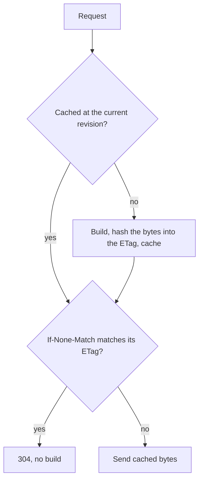
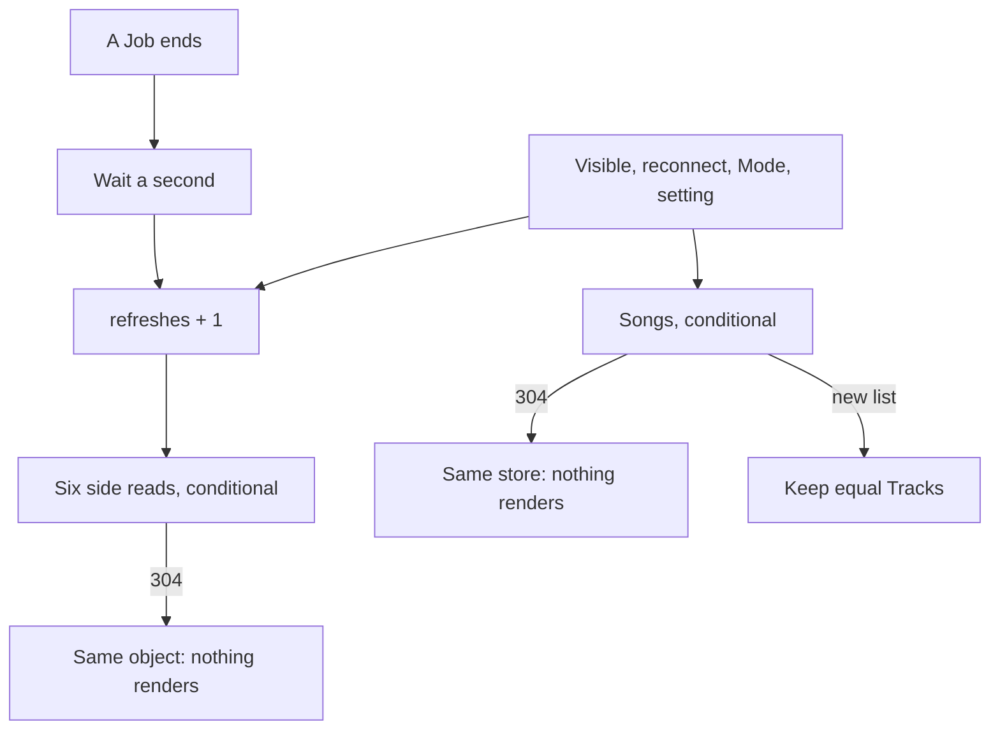

# Cheap reloads

> [!NOTE]
> **Status: implemented.** This note describes how the web client asks the server again
> only for what may have changed, and how an unchanged answer costs a small request
> and no rendering. It builds on [Cached reads](Cached%20reads.md), which gives the
> server's largest answers an ETag and a 304.

## Contents

- [Why](#why)
- [What it delivers](#what-it-delivers)
- [ETags that name the content](#etags-that-name-the-content)
- [Bookkeeping writes leave the revision alone](#bookkeeping-writes-leave-the-revision-alone)
- [More answers cached on the server](#more-answers-cached-on-the-server)
- [The enricher reads hold no time](#the-enricher-reads-hold-no-time)
- [Asking with the ETag held](#asking-with-the-etag-held)
- [Priority for supporting reads](#priority-for-supporting-reads)
- [Keeping what didn't change](#keeping-what-didnt-change)
- [When the side reads run](#when-the-side-reads-run)
- [Interfaces](#interfaces)
- [Boundary cases](#boundary-cases)
- [Testing](#testing)
- [Measuring](#measuring)
- [Deferred: changed songs announced](#deferred-changed-songs-announced)
- [Open questions](#open-questions)

## Why

The client reloads more than it needs to, and each reload renders everything again.

- **A heart click sends twelve reads.** Six *side reads* run again whenever the
  songs `Map` changes identity: artist names, names to tidy, split offers, artist
  splits, shared names, and artists missing a photo. A favorite or rating write
  changes that identity twice, once when the click shows and again when the server
  answers. Each change starts all six reads, and the first six answers are thrown
  away. Four of the six take 0.35–0.66 s on the server when they arrive together.
- **Returning to the tab sends seventeen reads.** The page becoming visible runs
  the full load: the songs, favorites, Playlists, the Mode, five enrichers, the
  Downloads, and the features. A new songs `Map` then starts the six side reads.
  This happens even when nothing has changed.
- **An unchanged answer still costs a full parse and render.** The browser
  revalidates the songs and gets a 304, but `fetch` hides it. The client parses
  1.2 MB of JSON and builds a new `Map` of 1,738 Tracks. No view is memoized, so
  every view on the page renders again.
- **The revision moves more often than the content.** Any row change moves the
  revision: a session's last-seen time, written once a minute by every signed-in
  request; a play; a Job's state. Each move changes every ETag of
  [Cached reads](Cached%20reads.md), even when the answer is the same.

## What it delivers

- [x] **ETags that name the content:** a rebuilt answer with the same bytes keeps
      its ETag, so it still answers 304.
- [x] **Bookkeeping writes leave the revision alone:** the last-seen times of
      sessions and devices don't trigger rebuilds.
- [x] **Five more cached answers:** names to tidy, artist splits, split offers,
      shared names, and artists missing a photo.
- [x] **Conditional reads in the client:** for each cached answer, the client keeps
      the last answer and its ETag, sends `If-None-Match`, and gets back the *same
      object* on a 304. One read per path runs at a time, and the newest answer
      wins.
- [x] **Unchanged songs keep their identity:** a list the server sends again keeps
      every Track that is equal, and keeps the `Map` when all are equal and in the
      same order.
- [x] **Side reads follow the Library, not the Account's own writes:** they run
      with each reload and after any Job ends, never because of a heart or a
      rating. Their 2 s polls keep running through 304s.
- [x] Before-and-after counts and timings: see [Measuring](#measuring).

- [x] **The enricher reads are kept too:** each says when a Track asked before may
      be asked again, and the page applies the wait.

Left out: per-view reads and caching favorites. See [Open questions](#open-questions).

## ETags that name the content

Today an ETag hashes the boot mark, the revision, and the key, so any write changes
it. Instead the ETag hashes the key and the answer's bytes; the revision only
decides when to rebuild.



- **A rebuild that changed nothing still answers 304.** After a play or a Job's
  state change, the side reads rebuild and find the same bytes, and the client
  gets a 304.
- **The boot mark is no longer needed.** An ETag from before a restart that
  matches the bytes now is still true.
- **The key stays in the hash,** so two Accounts with the same songs never share
  an ETag.
- **Hashing costs little:** SHA-256 of the 1.2 MB songs takes a few milliseconds,
  against the 0.18 s build.

## Bookkeeping writes leave the revision alone

Two writes run on nearly every request and change nothing any cached answer shows:
a session's `last_seen_at` in `AccountService.authenticate`, and a device's
last-seen time and address. Both are written at most once a minute, so after the
tab has been hidden a minute, the first request moves the revision and every cached
answer rebuilds.

`DatabaseRevision.ignoring()` is a static context manager that marks the current
thread, so a service needs no revision of its own to use it. A connection checked in
while the mark is set doesn't bump. Each bookkeeping write runs inside it:

```python
with DatabaseRevision.ignoring(), self._units.begin() as db:
    ...  # write last_seen_at
```

- **The rule:** a write may be ignored only if no cached answer reads what it
  changes. A test lists the tables each cached answer reads and fails if an
  ignored write touches one of them.
- **Scoped to the thread,** as `heavy_read` is, so another request's write on
  another thread still counts.

## More answers cached on the server

| Read | Key | Takes the heavy-read lock | Why it can be cached |
| --- | --- | --- | --- |
| `GET /api/names-to-tidy` | revision | no, as today | Built from Tracks and the names kept |
| `GET /api/artist-splits` | revision | no, as today | Built from artist names and decisions |
| `GET /api/split-offers` | revision | no, as today | Built from song lists found and files kept; the setting is in the database |
| `GET /api/shared-names` | revision | yes, as today | Built from Tracks, artists, and MusicBrainz flags |
| `GET /api/artist-photos/missing` | revision | yes, as today | Built from artists and pictures; "finding" comes from Job rows |

Each depends only on the database, with no clock and no Mode. The review read each
service to confirm this.

- **`CachedAnswers.answer` gains `heavy: bool`.** Today every build takes the
  heavy-read lock. With the flag, each read keeps the locking it has, and the three
  light reads don't queue behind the songs.
- **The routes that hold `heavy_read` today drop it,** and pass `heavy=True`
  instead; holding both would raise `HeavyReadReenteredError`.

## The enricher reads hold no time

`GET /api/enrichers/{name}` said which Tracks were asked in the last day, or the last
month for lyrics, so its answer changed with the clock and couldn't be kept. It now
sends what the rows say and lets the page apply each wait:

```json
{ "eligible": [12, 40], "waiting": { "12": "2026-11-21T09:30:00Z" }, "asks_again": true }
```

- **`eligible` lists every Track the enricher may be asked about apart from the
  wait.** The wait is the last reason checked, so a Track that waits is otherwise
  eligible.
- **`waiting` gives, for each of them asked before, when it may be asked again,**
  past times included, so nothing in the answer depends on when it was built.
- **`asks_again` is the AI's:** someone may choose to ask it again before the time
  comes, which the page shows as *asked lately*.
- **Whether the plugin is on names the answer,** with the enricher, since it is no
  row: the key is `("enricher", name, available)`. The build takes the heavy-read
  lock, as the read did.

The page works out which Tracks are findable with `askingAt(enricher, now)`, and sets
a timer for the next wait to pass, so a Track comes back without another read. The
server still refuses a lookup asked too soon, so a page whose clock runs ahead gets
the *Ask again?* question it gets today.

## Asking with the ETag held

`api.ts` gains a conditional read for the cached answers. It is a class, so each
test and each signed-in session starts with nothing held:

```ts
class HeldReads {
  /** The last answer of each path, and the ETag it came with. */
  private readonly held = new Map<string, { etag: string; value: unknown }>();
  /** The read under way for each path, and whether one more is wanted after it. */
  private readonly flying = new Map<string, { answer: Promise<unknown>; again: boolean }>();

  read<T>(path: string): Promise<T>; // sends If-None-Match; a 304 gives the held object
  forget(): void;                    // drops everything; called on every sign-out
}
```

- **Why send it ourselves.** `fetch` turns a browser revalidation's 304 into a 200
  holding the cached body, so the client can't tell an unchanged answer from a new
  one. A request that carries `If-None-Match` skips the HTTP cache, as the Fetch
  standard requires, so the 304 reaches the client.
- **The first read on a page** has nothing held. It goes through the browser's
  cache as before, so a page refresh still revalidates instead of downloading.
- **One read per path at a time.** A read asked for while one runs waits for a
  single trailing read, which starts when the first ends. Two callers asking at
  once share it. So an older answer can never land after a newer one, in the store
  or in `held`. This covers every path to the songs: `load`, and `reloadTracks`
  after a split, an added link or file, or a setting change.
- **Identity is the signal.** Callers don't get an "unchanged" flag: they get the
  very object they had. React state set to the same object doesn't render again,
  and the store treats the same array as no change. Held answers are frozen in
  development, so code that changes one fails at once.
- **Forgotten on every sign-out,** including a 401 that signs the page out, as the
  server's `Clear-Site-Data` clears the browser's copy.

## Priority for supporting reads

> [!NOTE]
> **Status: implemented.** Supporting Library reads have lower browser priority so
> a listener's editor or playback request can get a connection sooner.

### The remaining wait

Waiting until the songs are drawn prevents competing reads from delaying the
first song list. It does not keep the browser's connections free afterward.
The enricher and side reads can occupy them while the server rebuilds answers
under its heavy-read lock. An editor's small request can wait behind that work
before the server even receives it.

This is most visible when the server's cached answers are invalid. A warm server
cache makes the same reads cheap. Comparing one cold-cache opening with later
warm-cache openings would attribute that difference to the wrong change.

### Native priority, not another queue

Use the browser's [`RequestInit.priority`](https://developer.mozilla.org/en-US/docs/Web/API/RequestInit#priority)
hint, with no new package, application queue, concurrency cap, or delay:

| Collaborator | Responsibility |
| --- | --- |
| `HeldReads` | Accept an optional priority for the store's requests; keep conditional headers, shared trailing reads, errors, and object identity unchanged |
| The song-list store | Keep the browser's default priority |
| The supporting-read store | Request low priority for side and enricher reads, such as artist names, missing photos, and lookup eligibility |
| `forgetHeldReads` | Clear both stores when the signed-in Account changes |
| Other API calls | Keep their existing options and priority, including editor data, playback, and writes |

Separate stores make the priority a property of the read group without adding
options to every caller. A path belongs to one store, so its in-flight sharing
and trailing read remain in one place. Both stores must forget their answers
together; priority is not a new cache key or an Account boundary.

The hint changes which pending request the browser prefers. It cannot interrupt
a request already being served, guarantee a free connection, or make the server
build an answer faster. Browsers that ignore it keep their existing scheduling.
All reads still happen, with the same polling and invalidation rules.

These reads also supply Clean up, linked artist favorites, and station selection.
The grouping is not per-view priority: navigating there does not promote a
request already under way. Their readiness and behavior while reads remain
pending are part of the retention check, not an assumed free gain.

An experimental two-read concurrency cap reduces connection waiting further,
but does not consistently beat the native hint for Songs. It needs admission,
cancellation, and foreground-promotion rules; a queue package would not decide
those rules. The native hint is the smaller change and adds no dependency.

### Production measurements

Two seven-pair comparisons per action alternate baseline/implementation order in
silent headless Chrome. They use a disposable real API, a 1,906-track Library
with bound artist credits, and a 12-song album. Before each sample, the fixture
advances the database revision so cached answers need rebuilding. Outstanding
reads finish between samples. Source maps confirm that only the API module
differs between the production builds; the browser does not override priority.

Measurements use a desktop viewport without CPU or network throttling.
Each sample waits for one-minute host load at most four before starting and
refuses a sample above five. No build or test runs beside them. An incomplete
cohort that exceeded the ceiling is excluded as a whole. All samples in the
two completed comparisons remain in the results.

| Action | Useful controls, baseline → implementation | Frame proxy, baseline → implementation | Median paired frame saving |
| --- | --- | --- | --- |
| Edit details | 445 → 105 ms | 459 → 127 ms | 351 ms |
| Edit songs | 363 → 215 ms | 381 → 230 ms | 163 ms |
| Clean up: first Link artist names action | 480 → 700 ms | 538 → 764 ms | -251 ms |

The useful-control measure is click-to-DOM insertion of the first editable title
or an enabled action in Link artist names, not completion of every Clean up section.
Visibility and enabled state are checked afterward. The frame measure is a
`requestAnimationFrame` followed by a timer: a frame-opportunity proxy, **not
an exact presentation timestamp or standard first meaningful paint metric**.
The table uses separate medians; their difference need not equal the median
paired saving.

Details improves in 13 of 14 pairs, with a median paired 361 ms reduction
in the detail request's pre-send wait. Chrome reports supporting requests
as Low instead of High; editor requests stay High. The gain comes from
waiting less for a connection, not faster server computation.

Songs improves in 10 of 14 pairs, not consistently in each comparison.
Some baseline clicks occur after connections have already become free.
Others also cross the boundary between a preloaded Songs module and one
that still needs loading. The hint cannot improve work already served.

### Retention decision and limits

**Keep the hint for contested foreground reads, led by Edit details.**
The last supporting transfer finishes a median paired 1 ms later during
Details and 97 ms later during Songs. The hint changes service order and
adds no requests of its own; refresh rules remain unchanged.

Clean up's click-to-action wait is a median paired 224 ms longer across
the two comparisons. Click timing explains much of this difference:
in the second comparison, median baseline clicks occur 1,123 ms after
navigation starts, while candidate clicks occur at 707 ms. The action
itself appears at 1,396 versus 1,411 ms. Its navigation-anchored paired
change is 37 ms faster in the first comparison and 15 ms slower in
the second; artist-name response arrival is similarly mixed.
Earlier navigation does not make a listener's longer visible wait
disappear, so both measurements matter.
Across all 14 pairs, navigation-anchored action arrival is 1,401 → 1,414 ms,
with a paired 9 ms saving and seven pairs improving. Artist-name arrival
has a paired 1 ms delay, also with seven pairs improving. The click-time
difference follows variation in the initial track response, before
supporting reads start; it is not evidence that low priority delays
the action by 224 ms.

Warm-cache and fully preloaded controls do not establish a general gain.
Across eight warm-cache pairs, Songs has a median paired 5 ms content
delay and Clean up a 5 ms delay. Some Songs samples cross a roughly
260 ms module-preload boundary in either direction; the five-pair
follow-up does not show a consistently worse candidate preload state.
Three settled-opening pairs put Details at 69 → 65 ms and Songs at
87 → 85 ms, with mixed paired changes.

Click Event Timing is separate from useful content. The median is
64 → 56 ms for invalidated-cache Details and 56 → 56 ms for Songs.
Neither an INP improvement nor an everywhere-faster opening is claimed.

The comparisons cover Chrome over local HTTP, not every browser or network.
A browser that ignores the hint retains its own scheduling.

### Verified behavior

- [x] Supporting requests carry low priority on initial, conditional, and trailing
      reads; song-list, editor, playback, and write requests do not acquire it.
- [x] A 304 still returns the held object, overlapping reads still share one
      trailing request, and errors still allow recovery.
- [x] Changing Accounts clears both stores; a read begun before the change cannot
      repopulate either cache afterward.
- [x] The compiled implementation retains editor gains with invalidated server
      answers in paired measurements, not just the browser-side experiment.
- [x] Warm-cache and preloaded openings, supporting-data completion, and Clean up
      readiness are measured. Any reproducible supporting-view regression has an
      explicit keep-or-revert decision before retention.
- [x] While artist names are held at the network boundary, the existing favorite
      is still queued by the favorites station. After links arrive, that station
      also includes the linked name's song, in both builds.
- [x] Editor behavior still works at phone and desktop widths, in both themes and
      with reduced motion: drafts, selection, focus, validation updates, Escape,
      and reopening.

## Keeping what didn't change

The store's `loaded` action keeps what it can:

```ts
case "loaded": {
  if (action.tracks === store.listed) return store; // a 304: the same list
  const before = [...store.confirmed.values()];
  let same = action.tracks.length === before.length;
  const confirmed = new Map<number, Track>();
  action.tracks.forEach((track, index) => {
    const known = store.confirmed.get(track.id);
    const kept = known !== undefined && equalJson(known, track) ? known : track;
    same &&= before[index] === kept; // the same Track in the same place
    confirmed.set(track.id, kept);
  });
  return {
    ...store,
    confirmed: same ? store.confirmed : confirmed,
    listed: action.tracks,
    pending: /* as now */,
    loaded: true,
  };
}
```

- **An equal list keeps the `Map`,** so nothing renders. This still matters with
  content ETags: a play changes one Track's play count, and the list comes back
  with every other Track equal.
- **Order counts:** the same Tracks in a new order give a new `Map`, as the views
  show that order.
- **`equalJson` compares two JSON values deeply.** It is about fifteen lines,
  needs no upkeep when `Track` gains a field, and takes well under a millisecond
  for 1,738 Tracks.

## When the side reads run

Content ETags break one shortcut: the songs answering 304 no longer means the side
answers are unchanged. A Job that finds a split offer, for example, changes no
Track. So the side reads don't follow the songs; they follow a counter,
`library.refreshes`, that moves whenever the Library may have changed:

| Event | `refreshes` |
| --- | --- |
| A load (the page shown again, the event stream reconnecting, the Mode changing, a setting changing how songs show), once the songs answer | +1 |
| Any Job ending, a second after the last one ends; a load instead if one of them changes songs | +1 |
| An edited Track read back, or the songs read again after a change made here | +1 |
| A favorite or rating written | unchanged |

A load moves the counter once the songs answer, not as it starts, so the songs are
still read first and alone.

`Library` passes `library.loaded ? library.refreshes : undefined` to the six hooks.
Each side read is conditional, so a read that nothing changed answers 304 and keeps
its object: no render.

- **Any Job, not only those that change songs.** Finding pictures, finding an
  artist, and suggesting images change side answers but no Track. Six 304s cost
  little.
- **The polls follow a count of answers, not the answer.** `useArtistNames` and
  `FindPhotos` read again every few seconds while something is being found. A timer
  that depended on the answer object would stop at the first 304, which keeps it.
  Instead, each timer depends on `answered`, a count of the answers that came while
  something was still being found. An answer with nothing being found leaves the
  count alone, so an unchanged answer still renders nothing. `useReadAgain` keeps
  the count for `useMissingPhotos`, which passes it to `FindPhotos`.



## Interfaces

| Type | Where | Change |
| --- | --- | --- |
| `CachedAnswers.etag` | `web/cached.py` | Hashes the key and the bytes; no boot mark |
| `CachedAnswers.answer(..., heavy=)` | `web/cached.py` | Takes the heavy-read lock only when asked |
| `DatabaseRevision.ignoring()` | `persistence/revision.py` | New, static: writes on this thread inside it don't bump |
| Five side-read routes | `web/*.py` | Answer through `CachedAnswers`, with `responses=NOT_MODIFIED` |
| `HeldReads`, `forgetHeldReads` | `web/src/api.ts` | New: conditional, one-at-a-time reads by path; `App` forgets them when the Account changes |
| `api.tracks`, `api.artistNames`, the five side reads | `web/src/api.ts` | Read through `HeldReads` |
| `Store.listed` | `web/src/library/store.ts` | New: the array last loaded, so a 304 is no change |
| `equalJson` | `web/src/library/store.ts` | New: deep equality of two JSON values |
| `Library.refreshes` | `web/src/library/useLibrary.ts` | New: the count the side reads follow |
| `useReadAgain(..., changing)` | `web/src/library/useReadAgain.ts` | New argument; returns `answered`, the count the polls follow |
| `Askable`, `EnrichmentService.askable` | `application/enrichment.py` | New: the enricher's Tracks and waits, with no clock |
| `EnricherOut.waiting`, `.asks_again` | `web/enrichers.py` | Replace `asked_recently`; the read answers through `CachedAnswers` |
| `askingAt` | `web/src/library/asking.ts` | New: the findable and *asked lately* Tracks at a time, and when that changes |
| `serve()` routes' `etag` | `web/src/testing/server.ts` | New: a test server answers 304 to a request holding the ETag |

## Boundary cases

| Case | Behavior |
| --- | --- |
| The tab hidden for an hour, nothing changed | No revision move; the songs and every side read answer 304 |
| A song played meanwhile | The revision moves; the songs rebuild with one Track changed; side reads rebuild and answer 304 |
| The server restarts | Cached answers rebuild; equal bytes keep their ETags, so 304 |
| A read fails | The held answer stays; the next read sends its ETag again |
| A 304 arrives with nothing held | Treated as a refusal; the next read asks without an ETag |
| A read asked for during one under way | One trailing read after it, shared by every caller who asked |
| A favorite written during a load | The pending write overlays the list, as now; `refreshes` is unchanged |
| The same Tracks in a new order | A new `Map` |
| Two Accounts on one browser | Signing out forgets every held answer; their ETags differ anyway |
| The Mode goes Online or Offline | The songs' key changes on the server, so a new list |

## Testing

- **ETags:** a rebuild with the same bytes keeps the ETag and answers 304; one
  changed byte changes it; two Accounts never share one; a new boot no longer
  changes it.
- **`ignoring()`:** a write inside it leaves the revision alone, and one on another
  thread at the same time still bumps it; a signed-in request a minute later leaves
  the revision alone; no ignored write touches a table a cached answer reads.
- **Each newly cached read:** 304 for a matching `If-None-Match`; 200 after a write
  that changes it; the light ones never take the heavy-read lock; the cached bytes
  equal what the model serializes.
- **`HeldReads`:** no `If-None-Match` the first time, the held ETag after; a 304
  returns the very object held; a 200 replaces it; a refusal keeps it; reads asked
  during one under way share one trailing read; an older answer never replaces a
  newer one; `forget` drops all.
- **The store:** the same array gives the same store; an equal list keeps the `Map`
  and every Track; one changed Track keeps the rest; a new order gives a new `Map`;
  `equalJson` on nested arrays, objects, and `null`.
- **`useLibrary` and `Library`:** a heart click sends no side read; a load and a Job
  ending each send each side read once; two 304s in a row keep the 2 s polls going.
- **End to end:** returning to the tab with nothing changed sends the songs and the
  side reads, all answered 304, and the page doesn't render again.

## Measuring

On an Offline copy of the preview library of 1,738 songs, in headless Chromium, one
run each. *Return* is the page shown again after two minutes with nothing changed,
so the session's last-seen time is written first. *Heart* is one favorite given.
Main-thread time is Chromium's task time until the page is quiet.

| | Return, before | Return, after | Heart, before | Heart, after |
| --- | --- | --- | --- | --- |
| Requests | 17, all 200 | 17: 7 answered 304 | 13 | 1, the write |
| Bytes | 148 kB | 5.7 kB | 127 kB | 0.8 kB |
| Main-thread time | 187 ms | 104 ms | 136–206 ms | 63–148 ms |
| Last answer | 0.96 s | 0.40 s | 0.75–1.85 s | 0.08–0.13 s |

The ten reads still answered 200 on a return were the small uncached ones: favorites,
preferences, Playlists, the Mode, five enrichers, the Downloads, and the features.

The enricher reads were the heaviest of them: each built its answer under the
heavy-read lock, one after another. Kept, they answer 304 with no build. Measured
on two fresh Offline copies of the same library, before and after, with the songs
and the four enricher reads the page makes sent together with their ETags, five
times each:

| | Before | After |
| --- | --- | --- |
| Enricher answers | 4 × 200, built each time | 4 × 304 |
| Slowest enricher read | 293 ms | 30 ms |
| Last answer of the return | 309 ms | 32 ms |

## Deferred: changed songs announced

When one song changes, the songs read answers in full: 1.24 MB, or 82 KB with
gzip, for 1,738 songs. The client keeps every unchanged Track, so it renders
little, but it still downloads and parses the whole list. On a home network that
costs a few milliseconds, so this step waits.

The planned design sends only what changed, without a change log on the server:

- **The event stream announces changed songs.** After a write, `GET /api/events`
  names the Track ids it changed, such as *songs 42 and 97 changed*.
- **The client reads just those songs** with `GET /api/tracks/{track_id}`, puts
  each into the store, and drops ids that answer 404.
- **The full read stays the resync.** After a reconnect, a Mode change, a missed
  event, or anything the client can't account for, it reads the songs with the
  held ETag as it does today, and gets a 304 when nothing changed.

Rejected for now: a `?since=revision` patch. It needs the revision that last
changed each row, a record of removed songs and when to prune it, and a "too old,
read it all" answer. It also has to cover each Account's hearts, ratings, and
plays, and the Mode changing which songs are listed.

**Trigger:** a songs answer measured above about 500 KB gzipped, or a reload
measured as slow because of it. Pick it up together with paging, whose trigger is
a library past about 20,000 songs.

## Open questions

- **Per-view reads.** The plan listed reading the side reads only when a view needs
  them. All six feed the Clean up count on the rail, and the artist names feed every
  artist link, so they are needed on every view. With this note, an unchanged side
  read costs a 304. A further step could replace the five Clean up reads with one
  cached `GET /api/clean-up`: one request, one ETag. I'd leave both out, and
  revisit them if the measurements still show the side reads.
- **Favorites.** A heart moves the revision, and the client rebuilds its favorite
  groups from any answer, so caching them would buy nothing yet. Left out.
- **The name `refreshes`.** It counts the times the Library may have changed, as
  the side reads see it. Your call if another name reads better.
