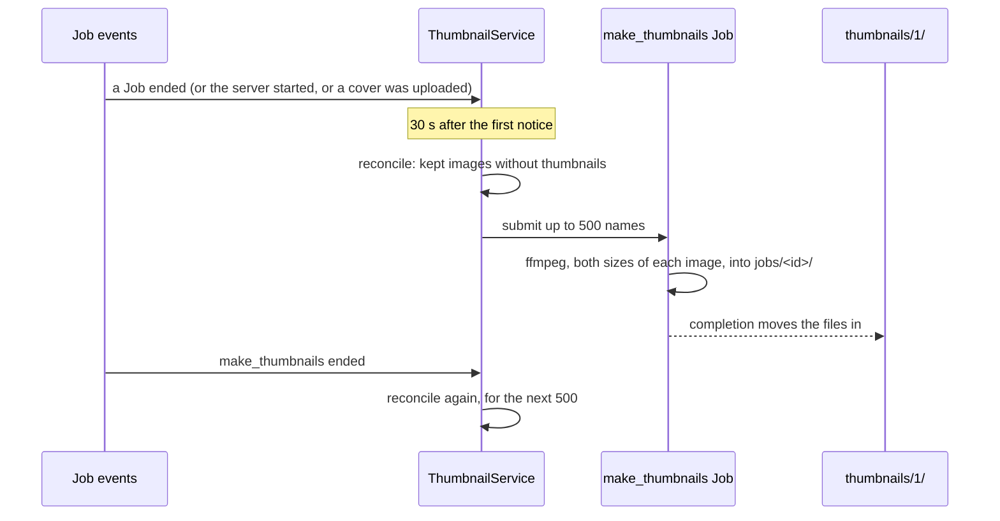

# Cover thumbnails

> [!NOTE]
> **Status: implemented.** This note describes how the server makes small copies of
> covers and photos, and how the web client shows them in rows and tiles instead of
> the full image. It follows [Cheap reloads](Cheap%20reloads.md), and runs ffmpeg
> through a plugin and a Job as [Plugin host](Plugin%20host.md) and [Jobs](Jobs.md)
> describe them.

## Contents

- [Why](#why)
- [What it delivers](#what-it-delivers)
- [Two sizes](#two-sizes)
- [Made ahead, by a Job](#made-ahead-by-a-job)
- [Serving a thumbnail](#serving-a-thumbnail)
- [The thumbnailer](#the-thumbnailer)
- [The client](#the-client)
- [Interfaces](#interfaces)
- [Boundary cases](#boundary-cases)
- [Testing](#testing)
- [Measuring](#measuring)
- [Left out](#left-out)

## Why

Every cover and artist photo is served as it was kept, whatever size it shows at.
In the preview library, the 256 kept images take 43.6 MB: a median of 172 kB and
1,728 pixels wide. A song row shows its cover at 36 CSS pixels, and an album tile
at about 160.

- **Bytes:** the Albums view loads a full image for every tile it shows, and the
  Library one for every row.
- **Decoding:** the browser decodes each image at full size, about 3 megapixels,
  before scaling it down. Decoding and keeping many of them is where scrolling
  stalls.
- **Memory:** a decoded square image of 1,728 pixels holds about 12 MB, against
  1 MB at 512.

## What it delivers

- [x] **Two thumbnail sizes** of every kept image, made by the new
      `ffmpeg-thumbnails` plugin: a *small* one of 128 pixels and a *medium* one of
      512.
- [x] **Made ahead:** the server compares the kept images with their thumbnails at
      startup, after changes, and after Jobs end, and one Job makes what is missing.
- [x] **`GET /api/covers/{name}?size=small&recipe=1`** answers with the thumbnail,
      kept by the browser as the original is. The recipe in the URL lets a better
      recipe reach browsers that kept the old one.
- [x] **No wait for a missing thumbnail:** the request is sent on to the original.
      When a thumbnail of that size will never be made, the browser keeps that answer.
- [x] **Every place an image shows names its size;** Now Playing's main image, the
      editors, and *Save* keep the original.
- [x] **Without the plugin or the program,** every request gets the original, as
      today.
- [x] Before-and-after counts and timings: see [Measuring](#measuring).

## Two sizes

| Size | Shorter side | Shown in | Median, preview covers |
| --- | --- | --- | --- |
| *small* | 128 px | Song rows, Up next, history, Downloading, the player bar, artist chips, search suggestions | 7 kB |
| *medium* | 512 px | Album, artist, Radio, and Insights tiles; the album and artist pages' art; the finders' grids; suggested photos; Now Playing's blurred backdrop and Dynamics | 59 kB |
| original | as kept | Now Playing's cover, the editors' main image, *Save*, the system's media controls | 172 kB |

- **128 pixels** covers a 36-pixel row at three device pixels per CSS pixel.
  **512** covers a tile up to 256 CSS pixels wide at two.
- **The shorter side is scaled to the size, never up,** and the aspect is kept,
  since the client crops with `object-fit: cover`. The longer side is capped at
  four times the size, so a banner stays small.
- **An image no larger than a size gets no thumbnail of that size.** Its requests
  go to the original, which is already small.
- **JPEG at quality 4** (ffmpeg's `-q:v` scale, where 2 is best). The ffmpeg this
  server runs has no WebP encoder, and JPEG is in every build. **An image with
  transparency** (a PNG or WebP with alpha) gets a PNG thumbnail instead, so it
  keeps its transparency.
- **Orientation:** ffmpeg turns a JPEG by its EXIF orientation, as browsers do with
  the original. A test holds it to that.

## Made ahead, by a Job



- **Reconcile** lists the covers folder and the thumbnails folder, and takes the
  names with no marker. Listing 256 files takes well under a
  millisecond; 20,000 would take a few.
- **When:** at startup, after the Job runner starts; 30 seconds after a change or
  a Job's change of state, so a run of enrichments becomes one reconcile; and every
  hour. Every image is kept by `keep_cover`, mostly in Job completions (scans,
  enrichment, the cover and picture finders, Wikidata photos, image links), and an
  upload arrives as a change of the catalog, so these cover them all without a
  hook in each. It runs on a sweeper of its own, as the enrichers' sweep does.
- **One Job at a time.** The kind has one target, `thumbnails`, and Jobs allow one
  active Job per kind and target. When a `make_thumbnails` Job ends, reconcile
  runs again and submits the next batch, until nothing is missing.
- **Both sizes in one run** of ffmpeg: one decode, two outputs, about 100 ms an
  image on this machine, after an `ffprobe` that reads its size. The preview's 254
  images took one Job 34 s, once.
- **It shares the runner's two slots** with downloads and lookups. A batch of 500
  holds one for about a minute; a waiting batch costs nothing but time, since
  requests meanwhile go to the originals.
- **It runs Offline:** it needs no network.
- **The program writes into its working folder,** `jobs/<id>/`, and reports its
  progress after each image. The completion checks each file begins as a JPEG or
  PNG and is at most 1 MiB, then moves it into `thumbnails/1/`, as
  `<name>-small` and `<name>-medium`. It does no database work, so it holds the
  write lock only as long as marking the Job does.
- **Markers** sit beside the thumbnails, so reconcile skips the image:
  `<name>.made` once its thumbnails are in, even when it needed none of a size,
  and `<name>.unreadable` for an image ffmpeg can't read. An image with either is
  *done*. A `no-tool` file, holding when the Job ended, pauses reconcile for an
  hour after ffmpeg was missing.

**The `1` is the recipe:** the sizes, the quality, and the rules above. The
thumbnails folder is `thumbnails/<recipe>/` in the data folder, beside `covers/`,
not inside it. A new recipe takes a new folder and a new number in the client, so
old thumbnails are never served by mistake, and a browser that kept them asks for
the new URL.

## Serving a thumbnail

`GET /api/covers/{name}` keeps its answer. A `size` of `small` or `medium`, with
the `recipe`, asks for a thumbnail:

| Thumbnail | Answer |
| --- | --- |
| Made, for the server's recipe | `200`, its type, `Cache-Control: private, max-age=31536000, immutable` |
| Not made yet, or another recipe | `307` to `/api/covers/{name}`, `Cache-Control: no-store` |
| Never to be made: the image is done, and small enough or unreadable | `307` to `/api/covers/{name}`, kept a year like a thumbnail |
| No such image | `404`, as today |
| An unknown `size`, or a `size` without a `recipe` | `422` |

- **A redirect for a thumbnail not made yet isn't kept,** so a later load asks
  again and gets the thumbnail once it is made. The original it leads to is kept
  as before, so a missing thumbnail costs what an image costs today, plus one
  round trip on the LAN.
- **A redirect that can't change is kept.** A done image's missing size is never
  made under this recipe, so the browser skips the round trip after the first
  visit: 15 of the preview's album tiles.
- **A page left open** keeps the images it already loaded until it reloads, so it
  sees new thumbnails late. Making them ahead keeps that rare.
- **The URL stays the content:** the image's name, the size, and the recipe. A
  thumbnail never changes under it, so it is kept a year, like the original.

## The thumbnailer

A new extension point in `plugin_api/covers.py`, implemented by a new plugin,
`ffmpeg-thumbnails`:

```text
ask      MakeThumbnails(source_path=covers/abc…, kind=image/png, name=abc…,
                        folder=jobs/41/, sizes=small 128 and medium 512, quality=4)
answer   status OK, with small=abc…-small, medium=abc…-medium (either may be absent:
         small enough), or NO_TOOL, UNREADABLE, or TIMED_OUT
```

- **Its own plugin,** not a second key of `ffmpeg`. Faults count per plugin, so a
  thumbnailer fault would otherwise turn off finding silences too, and the reverse.
  It is on by default, as `ffmpeg` is, and can be turned off on its own.
- **The input format is set from the image's kind** (`jpeg_pipe`, `png_pipe`, or
  `webp_pipe`), never guessed. Guessing would let ffmpeg probe other formats, such
  as playlists that read other files.
- **Limits:** an image whose size `ffprobe` reads as over 40 megapixels is
  unreadable before ffmpeg runs, and `-max_pixels 40000000` holds ffmpeg to it
  too; one thread; `-frames:v 1`; `-an -sn -dn`; `-nostdin`; and a 20-second
  timeout for each program. The Job's memory limit counts only the Job process,
  not ffmpeg's, so these are what bound ffmpeg.
- **An animated WebP is unreadable:** ffmpeg's WebP decoder reads only still
  images. Its requests go to the original, which browsers animate.
- **Transparency** is read with `ffprobe` from the pixel format, for PNG and WebP
  images only.
- **Fixed arguments, no shell,** as the silence finder runs ffmpeg.

| Status | What the service does |
| --- | --- |
| `OK` | Moves the files in and writes `made` |
| `UNREADABLE` | Writes the `unreadable` marker |
| `TIMED_OUT` | Nothing: the next reconcile tries again, a machine under load being likely |
| `NO_TOOL` | Stops reconciling for an hour, so a missing program costs one Job an hour |

The images come from uploads, scans, MusicBrainz, Deezer, Wikidata, and links a
model suggested. Decoding them is new: the server only sent them on before.
Decoding in a Job's process keeps a crash or a hang there out of the server and the
plugin host, which serves one call at a time.

## The client

- **`coverUrl(name, size)` takes a required size:** `"small"`, `"medium"`, or
  `"original"`. A thumbnail URL carries `recipe` from the client's
  `THUMBNAIL_RECIPE`. A required argument lets the type check find every place an
  image shows, including the `` elements outside `Cover`.
- **`Cover` takes a required `size`** and passes it on.
- **Every call site** takes the size the table under [Two sizes](#two-sizes) gives
  it: `TrackTable`, `QueuePanel`, `HistoryPanel`, `Downloading`, `PlayerBar`,
  `InsightsView`, `ArtistChips`, `SearchBox`, `Views`, `RadioView`, `AlbumAbout`,
  `ArtistAbout`, `SuggestedPhoto`, `FindPhotos`, `CoverFinder`,
  `ArtistPictureFinder`, `ImageLinks`, `EditAlbum`, `EditArtist`, `EditDetails`,
  `NowPlaying`, and the media controls in `usePlayer`.
- **A finished `make_thumbnails` Job refreshes nothing.** The client refreshes
  after any Job ends; thumbnails change no answer it reads.
- **Nothing else changes.** A redirected request loads the original as today, and
  `onError` still shows the stand-in.

## Interfaces

| Type | Where | Change |
| --- | --- | --- |
| `THUMBNAILER`, `MAKE_THUMBNAILS`, `MakeThumbnails`, `MadeThumbnails`, `ThumbnailSize`, `ThumbnailStatus`, `ImageKind`, `image_kind` | `plugin_api/covers.py` | New extension point and operation; an image's kind by its first bytes, which `is_cover_image` now uses |
| `FfmpegThumbnails` | `plugins/ffmpeg_thumbnails.py` | New plugin, `ffmpeg-thumbnails` |
| `MakeThumbnailsJob`, the program | `programs/make_thumbnails.py` | New: makes each named image's thumbnails in the working folder |
| `ThumbnailService` | `application/thumbnails.py` | New: `found(name, size)`, `done(name)`, `sweep()` (reconcile), `tidy()`; `make_thumbnails_kind` and its completion |
| `EnrichmentSweeper(..., what=)` | `application/sweeper.py` | Names what it sweeps; a second one runs reconcile 30 s after a change or a Job's change of state |
| `ThumbnailSize`, `THUMBNAIL_RECIPE` | `domain/covers.py` | New: `small` and `medium` with their pixels; the recipe number |
| `ThumbnailService.tidy` | `application/thumbnails.py` | Runs at startup after the covers' sweep: removes thumbnails and markers whose image is gone, and older recipes' folders |
| `GET /api/covers/{name}` | `web/covers.py` | New `size` and `recipe` queries |
| `coverUrl`, `CoverSize`, `Cover`, `THUMBNAIL_RECIPE` | `web/src/api.ts`, `web/src/views/Cover.tsx` | A required size; the recipe number |
| `CHANGES_NOTHING` | `web/src/library/useLibrary.ts` | A finished `make_thumbnails` Job refreshes nothing |

## Boundary cases

| Case | Behavior |
| --- | --- |
| `ffmpeg-thumbnails` is off, faulted, or quarantined | Reconcile submits nothing; every thumbnail request goes to the original |
| ffmpeg isn't installed | The Job answers `NO_TOOL`; reconcile waits an hour |
| An image ffmpeg can't decode, or over 40 megapixels | Marked unreadable; its requests go to the original |
| ffmpeg times out | Nothing is marked; the next reconcile tries it again |
| A `make_thumbnails` Job fails or is cancelled | Its images are still missing; the next reconcile, after a change, a Job, or the hourly tick, tries again. The service keeps no list of failures |
| An image no larger than a size | No thumbnail of that size; once the image is done, its requests go to the original with a redirect the browser keeps |
| An animated WebP | Unreadable to ffmpeg; its requests go to the original, which the browser animates |
| An image kept while a Job runs | The next reconcile, after that Job ends, takes it |
| The server restarts | Reconcile at startup takes whatever is missing |
| An image is no longer named by anything | At the next startup the covers' sweep removes it, then tidying removes its thumbnails and markers. Both run before the Job runner starts, so they never meet a running Job |
| A file the completion finds is not a JPEG or PNG, or is over 1 MiB | Dropped, and the image marked unreadable |
| An old client asks without a recipe, or with another one | `422` without one; `307` to the original with another |

## Testing

- **Service:** `found` finds a made thumbnail and nothing else, `done` holds once
  the Job answered for the image, and reconcile takes the images with no marker,
  caps a Job at 500, and submits nothing while one is active or the plugin is off;
  `NO_TOOL` pauses it for an hour. The completion moves good files, drops bad
  ones, and writes each marker. The Jobs run for real, with the test plugin
  `sketcher`, which answers as each image's label says, and a fake clock.
- **Plugin:** `FfmpegThumbnails` builds the arguments from the kind, the sizes, and
  transparency, and maps a missing program, a failed run, and a timeout to their
  statuses, with `run` and `which` faked as `FfmpegSilences` does. Real-ffmpeg tests,
  skipped when ffmpeg is missing, use small images: a wide JPEG, a banner, a PNG
  with alpha, a WebP with alpha and an animated one, a JPEG with EXIF orientation
  6, and a CMYK JPEG.
- **Program:** each image's kind from its bytes, each status kept, a file that is
  no image unreadable without asking, one no longer kept left out, and progress
  after each image.
- **Tidying:** thumbnails and markers of images gone go, those of kept images stay,
  and an older recipe's folder goes.
- **Routes:** each row of [Serving a thumbnail](#serving-a-thumbnail), with its
  headers.
- **Client:** `coverUrl` for each size; each call site's size, through the views'
  existing tests; a finished `make_thumbnails` Job sends no refresh.
- **End to end:** the Albums view asks for `size=medium` with the recipe, and a
  redirected image still shows.

## Measuring

On an Offline copy of the preview library (254 kept images, 43.5 MB), with the
plugin on, in headless Chromium at 1280 by 860, with an empty cache each time.
*After* is once the thumbnails are made. Each scenario ran four times *before*
(memory read in the last three) and three times *after*; the bytes never changed,
and the ranges cover the rest.

| | Albums, before | Albums, after | Library scrolled, before | Library scrolled, after |
| --- | --- | --- | --- | --- |
| Cover requests | 62 | 77: 62 images, 15 redirects | 129 | 129 |
| Image bytes | 12.3 MB | 3.8 MB | 21.6 MB | 0.9 MB |
| Median image | 209 kB | 62 kB | 174 kB | 7 kB |
| Renderer memory, most | 362–378 MB | 238–239 MB | 687–760 MB | 249–256 MB |
| Last image | 1.6–3.2 s | 1.6–1.8 s | 0.98–1.3 s | 0.93–0.99 s |
| Main-thread time | 0.58–1.0 s | 0.58–0.59 s | 0.61–0.86 s | 0.56–0.60 s |

- **Bytes and memory carry the change.** On the same machine the network costs
  nothing, so the time to the last image barely moves; over Wi-Fi, 21.6 MB is
  seconds and 0.9 MB is not. Images decode off the main thread, so its time
  barely moves either.
- **The 15 redirects** are tiles whose images are no larger than 512 pixels. The
  browser keeps them after the first visit.
- **Making thumbnails:** one Job made all 254 in 34 s: 254 small ones (1.7 MB, a
  median of 7 kB) and 172 medium ones (10.2 MB, a median of 59 kB). The other 82
  are no larger than 512 pixels.

## Left out

- **Media controls** keep the original. *medium* would do, and some systems refuse
  large artwork; nothing showed a need yet.
- **A failing `make_thumbnails` Job shows nowhere** but `GET /api/jobs`: the client
  has no list of Jobs. The originals still show meanwhile.
- **WebP thumbnails** need an ffmpeg built with an encoder for them; this one has
  none, so thumbnails are JPEG, or PNG with transparency.
