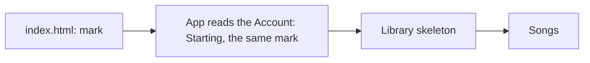

# No blank frames

> [!NOTE]
> **Status: implemented.** This note describes how the web client shows something at
> once wherever it now shows nothing: before its script runs, while the Account is
> read, and while a dialog, panel, or view waits for its code. It is the last of four
> steps after [Cached reads](Cached%20reads.md), [Cheap reloads](Cheap%20reloads.md),
> and [Cover thumbnails](Cover%20thumbnails.md).

## Contents

- [Why](#why)
- [What it delivers](#what-it-delivers)
- [A page before the script](#a-page-before-the-script)
- [The small parts load with the page](#the-small-parts-load-with-the-page)
- [A frame for each lazy part](#a-frame-for-each-lazy-part)
- [A part that fails to load](#a-part-that-fails-to-load)
- [Loading the rest while the browser is idle](#loading-the-rest-while-the-browser-is-idle)
- [Assets sent gzipped](#assets-sent-gzipped)
- [Interfaces](#interfaces)
- [Boundary cases](#boundary-cases)
- [Testing](#testing)
- [Measuring](#measuring)
- [Left out](#left-out)
- [Open questions](#open-questions)

## Why

Measured on the preview's library of 1,738 songs, in headless Chromium with the
network at 10 megabits a second and 40 ms of latency, as a phone on home Wi-Fi,
and the CPU slowed four times. Medians of three runs:

| Moment | Now |
| --- | --- |
| Browser's first paint | 0.54 s, an empty page |
| First content | 2.18 s |
| The rail of views | 2.24 s |
| The first song row | 4.4 s |
| Scripts and styles sent on a first visit | 1,085 KB |
| *Edit details* first opened: nothing shows for | 1.65 s |

Four things leave the page blank:

- **The page is empty until its script runs, and again until the Account is read.**
  `index.html` holds an empty `#root`; then `App` renders nothing until the server
  says who is signed in. A theme forced dark on a light system flashes light first,
  since `data-theme` is set only once the script runs.
- **A dialog shows nothing while its code loads.** Every Library dialog and Now
  Playing sit inside one `<Suspense fallback={null}>`. The first time one opens,
  nothing shows until its code arrives, and while it loads every other dialog in
  that boundary hides too. The Lyrics and Songs panels inside *Edit details* load
  the same way, so opening one hides *Edit details* itself.
- **The code waits in line, not on its size.** *Edit details* is 32 KB, a tenth of
  a second on that network. Its request waits for one of the browser's six connections
  to the server, behind the side reads, the event stream, and covers.
- **Scripts and styles are sent as they are.** The 850 KB entry script would be
  245 KB gzipped, the 198 KB of styles 32 KB. The browser keeps each for a year, so
  this costs on a first visit and after each upgrade.

A fifth risk is not blank yet but becomes one: after an upgrade, the old build's
files are gone, so a tab left open, as a music player's is, fails to load any part
it hasn't loaded, and today that takes the whole page down.

## What it delivers

- [x] **A page before the script:** the page's colors, in the theme the browser
      chose, and a quiet *medleyplay* mark, from the first paint until the Library's
      skeleton.
- [x] **The small parts load with the page:** Now Playing, *Edit details*, *Edit
      album*, *Add from Bilibili*, and *Add file*, about 15 KB gzipped.
- [x] **A frame for each lazy part,** each with its own boundary: a dialog's frame
      with its title and ✕, a panel's busy line, a view's *Loading…*.
- [x] **A part that fails to load says so in its place,** offers *Try again*, and
      never takes the page down. Any other error in it says something went wrong.
- [x] **The rest load while the browser is idle,** one at a time, once the Library
      has drawn, so a part opens at once and an upgrade can't break it.
- [x] **Assets are sent gzipped** to browsers that accept it, and keep their
      year-long caching through a 304.
- [x] Before-and-after measurements in the pull request.

## A page before the script

- **`index.html` gains a few lines of inline script** that read `medleyplay.theme`
  from `localStorage` and set `data-theme` on the root for `light` or `dark`, as
  `applyTheme` does, before the first paint. It never writes, and a storage error
  leaves the system's theme.
- **`<meta name="color-scheme" content="light dark">`** colors the canvas before the
  stylesheet arrives. The stylesheet already gives the body its page color.
- **The mark inside `#root`:** `<p class="starting" aria-busy="true">medleyplay</p>`,
  styled in `index.css`, in the muted ink.
- **`Starting` renders the same mark** while `App` reads the Account, where it now
  renders nothing. The Library's skeleton takes over from there.



## The small parts load with the page

Five lazy parts are small and used often: Now Playing 7 KB, *Add from Bilibili*
7 KB, *Edit album* 3 KB, *Add file* 3 KB, and *Edit details* 32 KB with what it
shares. Together they are about 15 KB gzipped, 5% of the entry script. Imported
like any other module, they need no frame, no preload, and can't go missing after an
upgrade. Now Playing needs no second, loading version of the big picture.

The parts that stay lazy are the large or rarely used ones:

| Part | Size | Opened from |
| --- | --- | --- |
| The list editor | 354 KB | the Songs panel's list mode |
| Settings | 85 KB | the rail |
| Clean up | 44 KB | the rail |
| The Songs panel | 30 KB | *Edit details* |
| Listen on a device | 27 KB | the player |
| The Lyrics panel | 13 KB | *Edit details* |
| Insights | 7 KB | the rail |

## A frame for each lazy part

`LazyPart` wraps one lazy part: an error boundary around a `Suspense` whose fallback
is the part's frame. The outer `fallback={null}` goes.

```tsx
<LazyPart frame={<DialogOpening title="Listen on a device" onClose={close} />}>
  <ListenOnDevice … />
</LazyPart>
```

| Part | Frame |
| --- | --- |
| Listen on a device | `DialogOpening` with its title and ✕ |
| The Songs and Lyrics panels | A busy line in the panel; *Edit details* stays open, with focus where it was |
| The list editor | `Opening the list…`, as today, now with its own boundary, so a failure leaves the Songs panel and its edits |
| Settings, Clean up, Insights | `Loading…` in the view, as today |

The frame of a dialog holds its place in the focus order: ✕ takes focus as the dialog
would, and Escape closes it.

## A part that fails to load

A part fails to load when the network drops, or after an upgrade removed the file it
asks for. Three things make that recoverable:

- **`lazyPart` forgets a failed load.** `React.lazy` keeps a rejected promise for
  good, and a browser may keep a failed module, so a part that failed would fail
  again on every open. `lazyPart` retries once after a second, and if that fails,
  the next open, or *Try again*, makes a fresh attempt.
- **The frame says what happened and offers what helps.** To tell the causes apart,
  it reads the page again, uncached, and compares the entry script it names with the
  one this page runs:

  | Cause | Says | Offers |
  | --- | --- | --- |
  | The page can't be read: the server can't be reached | *Can't reach medleyplay. Check the connection, then try again.* | *Try again* |
  | The page names another entry script: medleyplay was updated | *medleyplay was updated. Reload to open this; the music stops while the page reloads.* | *Reload* |
  | The page is the same: the load failed on the way | *This part of the page didn't load.* | *Try again* |
  | The part loaded but failed to show | *Something went wrong here.* | *Try again*; a dialog's ✕ still closes it |

- **Nothing reloads by itself.** A reload stops the music, so it waits for someone to
  choose it.

A boundary at the root catches anything else, so no error leaves an empty page.

## Loading the rest while the browser is idle

`lazyPart(load)` returns the component and a `preload()`. Once the Library has drawn
its first content, `preloadWhenIdle` loads each remaining lazy part in turn, each
with `whenIdle` from `library/stages.ts`, the helper the staged first load already
uses:

1. Listen on a device, the Lyrics panel, the Songs panel.
2. Settings, Clean up, Insights.
3. The list editor.

- **Every lazy part is preloaded,** the list editor too: a module the page has run
  stays in memory, so an upgrade can't break it. That is the main defense against a
  tab left open across an upgrade, and costs about 200 KB gzipped once per upgrade.
- **One at a time** keeps preloading to a single connection of the six, so it never
  holds up the reads and covers the page waits for.
- **The first content, not the first rows,** starts it, so an empty Library or a
  first load straight into Settings preloads too.
- **Add from Bilibili's own three-second timer goes;** it loads with the page.

## Assets sent gzipped

Browsers ask for Brotli only over HTTPS, and medleyplay serves plain HTTP on the home
network, so gzip is the encoding that counts.

- **Starlette's `GZipMiddleware` wraps `ClientFiles`,** and nothing else: the API's
  cached answers are gzipped already, and audio, covers, and the event stream must not
  be. It compresses answers over 500 bytes, skips ranges and answers already
  encoded, and adds `Vary: Accept-Encoding`. It runs at level 6, as the cached
  answers do: level 9 makes the entry script 1 KB smaller and takes 40% longer.
- **It costs compression time once per browser per upgrade,** since each asset is
  then kept for a year: about 90 ms for the entry script on this machine, in a
  worker thread.
- **A 304 for an asset keeps `immutable`.** `ClientFiles` sends `no-cache` on any
  answer but a 200 today, so a browser revalidating an asset learned to ask again
  every time.

On a first visit this sends about 290 KB instead of 1,085 KB.

## Interfaces

| Type | Where | Change |
| --- | --- | --- |
| `index.html` | `web/index.html` | Inline theme script, `color-scheme`, the starting mark |
| `Starting` | `web/src/views/Starting.tsx` | New: the mark while the Account is read |
| `lazyPart(load)` | `web/src/lazyPart.tsx` | New: a lazy component with `preload()`, that retries a failed load once, then lets the next try load afresh |
| `forgetFailedLoads()` | `web/src/lazyPart.tsx` | New: what *Try again* calls, so each part that failed loads afresh |
| `preloadWhenIdle(parts, signal)` | `web/src/lazyPart.tsx` | New: loads each part in turn with `whenIdle` |
| The lazy parts and `PRELOADED` | `web/src/views/parts.ts` | New: each part declared once, and the preload order |
| `LazyPart` | `web/src/views/LazyPart.tsx` | New: an error boundary and a `Suspense` around one part, with its frame and what to say when it fails |
| `DialogOpening` | `web/src/views/DialogOpening.tsx` | Shows its children: the busy line, or the failure |
| The root's boundary | `web/src/main.tsx` | A `LazyPart` around `App` |
| Five parts | `web/src/views/Library.tsx` | Imported with the page |
| `client_app` | `src/medleyplay/web/pages.py` | Wraps `ClientFiles` in `GZipMiddleware` |
| `ClientFiles.get_response` | `src/medleyplay/web/pages.py` | `immutable` on a 304 for an asset too |

## Boundary cases

| Case | Behavior |
| --- | --- |
| A part fails to load while offline | Its frame says the server can't be reached, with *Try again*; the rest of the page keeps working |
| A part's file is gone after an upgrade | Its frame offers *Reload*, saying the music stops |
| A load fails on the way, the server still serving this build | *This part of the page didn't load*, with *Try again* |
| A preload fails | Forgotten; opening the part tries again, behind its frame |
| A part loads, then throws while showing | *Something went wrong here*, with *Try again*; not the upgrade message |
| The dialog is closed while its code loads | The frame's ✕ closes it; the code still lands, for next time |
| Two lazy parts open, one loading | Each has its own boundary, so the other stays |
| A request without `Accept-Encoding: gzip`, or a range | The original bytes |
| `localStorage` unreadable | The inline script does nothing; the system's theme shows |
| A browser without `requestIdleCallback` | `whenIdle`'s timer |
| The browser asks to save data | Preloading still runs: on a home network the risk of a broken part after an upgrade costs more than 200 KB once |

## Testing

- **`lazyPart`:** `preload()` loads once however often called; a failed load is
  retried once and then forgotten, so the next call loads again.
- **`preloadWhenIdle`:** the parts load in order, one at a time, each on an idle
  callback; stopping the signal stops the rest; a failed preload is swallowed.
- **`LazyPart`:** shows its frame while loading and the part once loaded; a failed
  load shows the right message for an unreachable server, a newer build, and the
  same build, and *Try again* loads afresh; an error while rendering shows *Something went
  wrong*; two parts load independently.
- **`App`:** shows the starting mark while the Account is read.
- **`index.html`:** the inline script's key is the one `theme.ts` keeps.
- **The Library:** preloading starts once the Library has drawn, not before. That
  the Lyrics and Songs panels and the list editor keep *Edit details* open while they
  load or fail follows from each having its own `LazyPart`, which `LazyPart`'s own
  tests cover.
- **`ClientFiles`:** an asset is sent gzipped, with `Vary`, to a request that accepts
  gzip, and as it is otherwise; a 304 for an asset keeps `immutable`.
- **End to end:** the built client loads with gzipped assets, and opening *Edit
  details* shows the dialog at once.

## Measuring

On two fresh Offline copies of the preview library, one served by main and one by
this change, with the network and CPU slowed as in [Why](#why). Medians of three
runs:

| Moment | Before | After |
| --- | --- | --- |
| Browser's first paint | 0.53 s, an empty page | 0.25 s, the starting mark |
| First content | 1.81 s | 0.25 s |
| The rail of views | 1.84 s | 1.66 s |
| The first song row | 2.79 s | 2.07 s |
| Scripts and styles, the first visit and four seconds after | 1,107 KB, no part preloaded | 484 KB, every part preloaded |
| *Edit details* shows nothing for | 344 ms | 21 ms |
| Settings, opened four seconds after the page | 544 ms | 546 ms |
| Long tasks in the four seconds after the first row | 6 | 6 |

- **The baseline is lower than in [Why](#why)** because main now keeps the enricher
  reads, so fewer slow reads hold the browser's connections.
- **Settings opens no faster:** its code is preloaded and no file is fetched on the
  click, but drawing it takes about 440 ms on the slowed CPU before it reads its
  settings. That is the view's own cost, outside this note.
- **Preloading adds no long tasks** in the window it runs.

## Left out

- **Brotli.** Browsers ask for it only over HTTPS. Revisit if medleyplay serves
  HTTPS.
- **Compressing every JSON answer.** The largest are gzipped already by
  [Cached reads](Cached%20reads.md); the rest are small.
- **Telling an open tab a new version is out.** The server would announce its build
  on the event stream, and the page would offer to reload between songs. Its own step,
  if stale tabs prove common.
- **Loading on intent,** such as hovering a control to load what it opens. Idle
  preloading covers it.
- **A smaller entry script.** This note makes the entry 15 KB larger on purpose.
  Splitting out what the first view doesn't need is its own step, to measure after
  this one.

## Open questions

- **Preloading when the browser asks to save data.** I'd preload anyway, for the
  reason in [Boundary cases](#boundary-cases). Your call if a phone's data plan
  matters more here.
- **The mark.** The word *medleyplay* in muted ink, centred. A logo would need one
  first.
