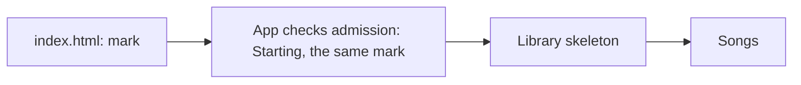

# No blank frames

> [!NOTE]
> **Status: implemented.** This note describes how the web client shows something at
> once wherever it now shows nothing: before its script runs, while the Account is
> read, and while a dialog, panel, or view waits for its code. It is the last of four
> steps after [Cached reads](Cached%20reads.md), [Cheap reloads](Cheap%20reloads.md),
> and [Cover thumbnails](Cover%20thumbnails.md).
> Cold-part readiness covers the same boundary when its code is not ready yet.

## Contents

- [Why](#why)
- [What it delivers](#what-it-delivers)
- [A page before the script](#a-page-before-the-script)
- [The small parts load with the page](#the-small-parts-load-with-the-page)
- [A frame for each lazy part](#a-frame-for-each-lazy-part)
- [A part that fails to load](#a-part-that-fails-to-load)
- [Loading the rest while the browser is idle](#loading-the-rest-while-the-browser-is-idle)
- [Opening a part whose code is ready](#opening-a-part-whose-code-is-ready)
- [Cold-part readiness](#cold-part-readiness)
- [Assets sent gzipped](#assets-sent-gzipped)
- [Interfaces](#interfaces)
- [Boundary cases](#boundary-cases)
- [Testing](#testing)
- [Measuring](#measuring)
- [Left out](#left-out)
- [Open questions](#open-questions)

## Why

Measured on the preview's library of 1,738 songs, in headless Chromium with the
network at 10 megabits a second and 40 ms of latency, as a phone on home Wi-Fi,
and the CPU slowed four times. Medians of three runs:

| Moment | Now |
| --- | --- |
| Browser's first paint | 0.54 s, an empty page |
| First content | 2.18 s |
| The rail of views | 2.24 s |
| The first song row | 4.4 s |
| Scripts and styles sent on a first visit | 1,085 KB |
| *Edit details* first opened: nothing shows for | 1.65 s |

Four things leave the page blank:

- **The page is empty until its script runs, and again until the Account is read.**
  `index.html` holds an empty `#root`; then `App` renders nothing until the server
  says who is signed in. A theme forced dark on a light system flashes light first,
  since `data-theme` is set only once the script runs.
- **A dialog shows nothing while its code loads.** Every Library dialog and Now
  Playing sit inside one `<Suspense fallback={null}>`. The first time one opens,
  nothing shows until its code arrives, and while it loads every other dialog in
  that boundary hides too. The Lyrics and Songs panels inside *Edit details* load
  the same way, so opening one hides *Edit details* itself.
- **The code waits in line, not on its size.** *Edit details* is 32 KB, a tenth of
  a second on that network. Its request waits for one of the browser's six connections
  to the server, behind the side reads, the event stream, and covers.
- **Scripts and styles are sent as they are.** The 850 KB entry script would be
  245 KB gzipped, the 198 KB of styles 32 KB. The browser keeps each for a year, so
  this costs on a first visit and after each upgrade.

A fifth risk is not blank yet but becomes one: after an upgrade, the old build's
files are gone, so a tab left open, as a music player's is, fails to load any part
it hasn't loaded, and today that takes the whole page down.

## What it delivers

- [x] **A page before the script:** the page's colors, in the theme the browser
      chose, and a *medleyplay* mark with a small loading ring from the first paint.
- [x] **The small parts load with the page:** Now Playing, *Edit details*, *Edit
      album*, *Add from Bilibili*, and *Add file*, about 15 KB gzipped.
- [x] **A frame for each lazy part,** each with its own boundary: a dialog's frame
      with its title and ✕, a panel's busy line, a view's *Loading…*.
- [x] **A part that fails to load says so in its place,** offers *Try again*, and
      never takes the page down. Any other error in it says something went wrong.
- [x] **The rest load while the browser is idle,** one at a time, once the Library
      has drawn, so a part opens at once and an upgrade can't break it.
- [x] **Assets are sent gzipped** to browsers that accept it, and keep their
      year-long caching through a 304.
- [x] Before-and-after measurements in the pull request.

## A page before the script

- **`index.html` gains a few lines of inline script** that read `medleyplay.theme`
  from `localStorage` and set `data-theme` on the root for `light` or `dark`, as
  `applyTheme` does, before the first paint. It never writes, and a storage error
  leaves the system's theme.
- **`<meta name="color-scheme" content="light dark">`** colors the canvas before the
  stylesheet arrives. The stylesheet already gives the body its page color.
- **The mark inside `#root`:** `<p class="starting" aria-busy="true">medleyplay</p>`,
  styled in `index.css` with muted ink and a small CSS ring. The ring spins only
  when the browser does not request reduced motion.
- **`Starting` renders the same mark** in the same position while `App` checks the
  device and reads the Account. It gives way to device approval, sign-in, or the
  Library.



## The small parts load with the page

Five lazy parts are small and used often: Now Playing 7 KB, *Add from Bilibili*
7 KB, *Edit album* 3 KB, *Add file* 3 KB, and *Edit details* 32 KB with what it
shares. Together they are about 15 KB gzipped, 5% of the entry script. Imported
like any other module, they need no frame, no preload, and can't go missing after an
upgrade. Now Playing needs no second, loading version of the big picture.

The parts that stay lazy are the large or rarely used ones:

| Part | Size | Opened from |
| --- | --- | --- |
| The list editor | 354 KB | the Songs panel's list mode |
| Settings | 85 KB | the rail |
| Clean up | 44 KB | the rail |
| The Songs panel | 30 KB | *Edit details* |
| Listen on a device | 27 KB | the player |
| The Lyrics panel | 13 KB | *Edit details* |
| Insights | 7 KB | the rail |

## A frame for each lazy part

`LazyPart` wraps one lazy part: an error boundary around a `Suspense` whose fallback
is the part's frame. The outer `fallback={null}` goes.

```tsx
<LazyPart frame={<DialogOpening title="Listen on a device" onClose={close} />}>
  <ListenOnDevice … />
</LazyPart>
```

| Part | Frame |
| --- | --- |
| Listen on a device | `DialogOpening` with its title and ✕ |
| The Songs and Lyrics panels | A busy line in the panel; *Edit details* stays open, with focus where it was |
| The list editor | `Opening the list…`, as today, now with its own boundary, so a failure leaves the Songs panel and its edits |
| Settings, Clean up, Insights | `Loading…` in the view, as today |

The frame of a dialog holds its place in the focus order: the empty dialog
itself takes focus, and Escape closes it.

## A part that fails to load

A part fails to load when the network drops, or after an upgrade removed the file it
asks for. Three things make that recoverable:

- **`lazyPart` forgets a failed load.** `React.lazy` keeps a rejected promise for
  good, and a browser may keep a failed module, so a part that failed would fail
  again on every open. `lazyPart` retries once after a second, and if that fails,
  the next open, or *Try again*, makes a fresh attempt.
- **The frame says what happened and offers what helps.** To tell the causes apart,
  it reads the page again, uncached, and compares the entry script it names with the
  one this page runs:

  | Cause | Says | Offers |
  | --- | --- | --- |
  | The page can't be read: the server can't be reached | *Can't reach medleyplay. Check the connection, then try again.* | *Try again* |
  | The page names another entry script: medleyplay was updated | *medleyplay was updated. Reload to open this; the music stops while the page reloads.* | *Reload* |
  | The page is the same: the load failed on the way | *This part of the page didn't load.* | *Try again* |
  | The part loaded but failed to show | *Something went wrong here.* | *Try again*; a dialog's ✕ still closes it |

- **Nothing reloads by itself.** A reload stops the music, so it waits for someone to
  choose it.

A boundary at the root catches anything else, so no error leaves an empty page.

## Loading the rest while the browser is idle

`lazyPart(load)` returns the component and a `preload()`. Once the Library has drawn
its first content, `preloadWhenIdle` loads each remaining lazy part in turn, each
with `whenIdle` from `library/stages.ts`, the helper the staged first load already
uses:

1. Listen on a device, the Lyrics panel, the Songs panel.
2. Settings, Clean up, Insights.
3. The list editor.

- **Every lazy part is preloaded,** the list editor too: a module the page has run
  stays in memory, so an upgrade can't break it. That is the main defense against a
  tab left open across an upgrade, and costs about 200 KB gzipped once per upgrade.
- **One at a time** keeps preloading to a single connection of the six, so it never
  holds up the reads and covers the page waits for.
- **The first content, not the first rows,** starts it, so an empty Library or a
  first load straight into Settings preloads too.
- **Add from Bilibili's own three-second timer goes;** it loads with the page.

## Opening a part whose code is ready

> [!NOTE]
> **Status: implemented.** A part whose code has already loaded renders without
> another module-loading suspension. Code splitting, loading frames, retries, and
> edits are preserved.

### What makes the window wait

Downloading code and showing useful controls are separate milestones.
Keeping only the module's promise makes the first render initialize a fresh
`React.lazy` component through another promise. That render can suspend even
though the module is ready. React can then delay revealing the part; its effects,
including the Songs request, cannot start until it mounts. Keeping the resolved
component too avoids that unnecessary suspension.

In the measured React 19.3.1 baseline, a preloaded list editor schedules a roughly
300 ms timer after showing its loading frame. The ready-component path removes
that wait and starts list validation earlier. Songs likewise starts its data
request earlier. That wait is not time spent downloading the module or rendering
song rows.

React documents [lazy initialization](https://react.dev/reference/react/lazy) and
[Suspense's reveal timing and initial-state behavior](https://react.dev/reference/react/Suspense).
The duration is a framework detail, not an application timer to override.

### Rendering boundary

`lazyPart` owns this behavior, with the existing `Part<P>` interface:

| Collaborator | Responsibility |
| --- | --- |
| `lazyPart` | Remembers the successfully loaded component as well as the shared promise |
| The part's `Component` wrapper | Captures its rendering mode, load generation, and already-ready component once per mount |
| `LazyPart` | Provides the loading frame, error messages, and keyed remount on retry |
| `preloadWhenIdle` | Keeps the order, cancellation, and single-part loading policy |

A state initializer selects the component once per mount. A later parent update
must not replace a mounted lazy component with its resolved component: changing
element type risks discarding editor state. React may retry an uncommitted suspended
tree from scratch; that is distinct from resetting an editor already in use.

| State at opening | Behavior |
| --- | --- |
| Code already loaded | Render it directly, with no module-loading suspension |
| Code absent or still loading | Use the local frame described in [Cold-part readiness](#cold-part-readiness); plain Suspense callers keep the native lazy path |
| Preload failed | Preserve the existing retry and failure-reset behavior |
| Loaded component throws | Preserve the rendering-error boundary, not an upgrade warning |
| Parent updates during editing | Preserve the component, draft, focus, and selection |
| Closed before loading finishes | Keep the successful module available for the next opening |

This does not make editors eager, prefetch song data, cache drafts, change API
scheduling, or replace the native modal focus policy. Moving more code into the
entry bundle would charge every page load; changing React's internal timer would
couple the app to an implementation detail. Neither is needed for the preloaded case.

Earlier content affects initial focus: the available *Details* button takes focus
where the baseline initially focuses the empty dialog. The native first-control
policy stays the same, without moving focus again when song data arrives. Keyboard
checks cover that intentional difference as well as preserving focus and selection
during editing.

### Window readiness measurements

Production builds, silent headless Chrome 158.0.8127.89, a disposable real API with
1,906 synthetic tracks and a 12-song album, desktop viewport, and no CPU or network
throttling. Each sample uses a fresh browser context. The preloaded case waits for
the last module download and another second; traces confirm no editor module
request during opening. Seven adjacent baseline/candidate pairs alternate order,
with no concurrent build or test process owned by the experiment.

The primary measure is click-to-DOM insertion of the selected useful control:
the first song title, editable song list, or Settings' language selector. Settings
does not wait for every section's data, and the list does not wait for validation.
A following `requestAnimationFrame` plus timer provides a frame-opportunity proxy,
**not an exact presentation timestamp or a standard first meaningful paint metric**.
Visibility and enabled state are checked afterward, not at the recorded DOM
timestamp. Separate traces and screenshots corroborate earlier visible content.

| Action | Useful controls, baseline → implementation | Frame proxy, baseline → implementation | Median paired frame saving |
| --- | --- | --- | --- |
| Edit songs | 376 → 120 ms | 395 → 137 ms | 258 ms |
| Fill from a list | 346 → 49 ms | 358 → 65 ms | 294 ms |
| Settings | 147 → 54 ms | 211 → 108 ms | 91 ms |

Every first-opening pair improves for these preloaded parts. Eager Edit details,
Edit album, and cover editors are not changed by this loading path; no gains are
claimed for them. Machine load changes during the run, so paired differences
matter more than absolute timing guarantees.
The table uses separate medians; subtracting its columns need not equal the median
paired saving.

The interaction tradeoff is explicit: median click Event Timing duration rises
from 24 to 72 ms for the list, 72 to 80 ms for Songs, and 24 to 32 ms for Settings.
The list's construction moves into the initial interaction. Useful content
appears much earlier, but this is **not an INP improvement claim**.

Reopening is essentially unchanged: median paired frame differences are 0.4–1.1 ms
slower, with mixed per-pair results. The gain is on the first opening after code
loads, not every opening.

A separate 100-song fixture retains the gain in all three pairs per editor.
Songs' useful controls move from 429 to 176 ms, with the frame proxy moving from
506 to 259 ms. The list moves from 381 to 95 ms, with the frame proxy moving from
395 to 113 ms. Its click duration rises from 56 to 120 ms; Songs stays at 80 ms.

There are two important exclusions:

- **A genuinely cold opening still waits.** With 40 ms network latency and a
  limit of 10 megabits per second, the Songs module request starts after the click
  in both builds.
  Three pairs put useful controls at 397 ms versus 407 ms, and the frame proxy
  at 413 ms versus 424 ms. Two pairs are slower; one baseline opening also waits
  behind startup work and takes about a second. This change does not remove the
  cold loading delay or guarantee lower latency in every case.
- **Startup requests can occupy the connections.** One early Edit details sample
  waits 1,750 ms before its HTTP request is sent, while the API reports 61 ms of
  application time. Enricher status and other side reads occupy the connections;
  an event stream keeps another open. Other early samples are much faster.
  [Priority for supporting reads](Cheap%20reloads.md#priority-for-supporting-reads)
  addresses that separate wait; it is not a benefit of preloaded-part rendering.

Edit album also has time between DOM insertion and the next frame that the lazy
path does not explain. Removing backdrop blur in a separate three-pair experiment
changes the frame proxy from 96 to 93 ms and leaves most of that delay. That does
not justify changing its appearance; the remaining native browser work needs
further attribution.

### Verified behavior

- [x] A fulfilled preload renders synchronously without showing the loading frame.
- [x] Absent and pending modules keep their frame, shared load, retry interval,
      failure messages, and recovery through the existing boundary.
- [x] Cold-loaded and preloaded editors preserve drafts and focus on parent
      updates; closing during loading does not prevent a later opening.
- [x] Focused tests exercise these contracts through components, not React internals.
- [x] Production comparisons retain the preloaded Songs/list gains and check cold
      opening, reopening, and a larger song list without hiding regressions.
- [x] Settings comparisons cover useful content and click duration for a non-editor
      consumer of the same loading helper.
- [x] Headless browser checks cover editing, validation-driven parent updates,
      focus and selection, Escape, and reopening at desktop and phone widths in
      light and dark themes, with normal and reduced motion.

## Cold-part readiness

> [!NOTE]
> **Implemented.** Show module-loading feedback through a local context and
> React state, without changing the public part contract or its callers.

Native module suspension can finish downloading the Songs editor and then wait
roughly another quarter-second before mounting. Its song-data request
starts only after that mount. This is separate from connection waiting
and from the already-fixed preloaded case.

Three paired diagnostic samples hold an in-flight Songs module until its loading
frame is visible, then release it. The production baseline shows useful
controls about 360 ms after the click, with about 285 ms between module
response completion and controls. A build-only experiment removes
React's internal fallback throttle: controls appear in about 109 ms,
with about 42 ms after the response. Every pair improves.

These are causal diagnostic results, not retained implementation numbers.
The experiment changes no source or installed dependency file, but its
build transform deliberately changes an internal React constant.
**That transform must not ship.** There is no supported application
setting for that internal timer in the reviewed React API documentation.

### Contained rendering boundary

The design keeps dynamic imports, shared loads, idle
preloading, and the existing error UI, but shows module-loading frames
through explicit React state instead of suspending for module loading.
Nested component suspension, if any, still belongs to React.

| Option | Benefit | Cost |
| --- | --- | --- |
| Keep `React.lazy` and Suspense | Preserve the current contract and framework-managed loading | Keep the measured cold-opening delay |
| Add an internal loading-frame context | Show loaded code without the module-reveal throttle; keep callers unchanged | Maintain a state-driven rendering path beside plain Suspense compatibility |
| Make more parts eager | Avoid cold module suspension | Charge every startup for code that may not be opened |

`LazyPart` provides its existing loading frame through an internal
`PartFrame` context. Its error boundary and Suspense stay in place,
including the root wrapper around `App`. A `Part.Component` captures its
rendering mode and load generation once per mount. Within that context,
a small state-driven component shows the frame while loading, then the
resolved component. Without the context, it keeps the existing
`React.lazy` path. Changing frame content does not switch a mounted
editor between component types.

Each loaded component clears the inherited frame context around its
descendants. A nested part must use its own frame or ordinary Suspense,
not reuse the outer dialog's frame. Suspense still handles actual
component suspension; only this helper's module-loading wait changes.

The shared load and retry mechanism remains in `lazyPart`. Each load
generation owns both the native lazy component and a cached opening
failure. Both rendering paths call the same generation's opening
function. This distinguishes a failed background preload from a failure
already presented by an opened part:

| State | Opening or update |
| --- | --- |
| Ready | Render the saved component immediately and keep its type stable. |
| Absent or pending | Show the local frame and share the existing load promise. |
| Background preload failed | An opening may start a fresh attempt, as the unused native lazy component does. |
| An opened part failed | Closing and reopening keeps that generation's error; do not silently retry. |
| Try again or a new preload after failure | Reset the failed generation, preserving the existing retry interval and classification. |
| Closed before completion | Ignore that instance's late result while keeping the shared module load. |

The framed component is created once per `lazyPart` factory, not during
rendering. It observes its generation through an effect with
cleanup, using React state for pending, ready, and failed results.
`StrictMode` effect replay still shares one load. No global subscription
store, private React timer change, synchronous flush, or new preload
policy is needed.

### Dependency choice and tradeoff

React is already a dependency and supplies the context, state, and effect
APIs needed to adapt the existing loader. Its guidance
[prefers React state where possible](https://react.dev/reference/react/useSyncExternalStore#caveats).
The existing code already owns retry and preload behavior.

The registry and [loadable component API](https://loadable-components.com/docs/api-loadable-component/)
were checked: `@loadable/component` declares React 19 compatibility but introduces
another loader, additional dependencies, and different preload semantics.
`react-loadable` also introduces a separate loading model. These packages
are not recommended or installed; no runtime compatibility claim is made for
either. Reusing existing React primitives avoids replacing the loader
to change one rendering wait.

A quickly arriving module may show the busy frame for only one or two
frames. That brief feedback is intentional; there is no minimum spinner
duration. Keyboard checks must establish that replacing `DialogOpening`
does not invoke the user's close callback, lose Escape handling, or
reset a draft. Changes to public props, caller structure, failure UX,
dependencies, or the set of eagerly loaded parts require a separate decision.

### Required invariants

- A ready component renders immediately and keeps its identity, edits,
  focus, and selection through parent updates.
- Pending code shares one load and keeps an accessible, closable frame.
- Closing during loading neither cancels the shared load nor updates an
  unmounted view; a later opening can use the completed module.
- Retry timing, failure classification, explicit recovery, and isolation
  between two open parts remain unchanged.
- Preload failure and failure after opening have defined recovery paths;
  changing either requires an explicit decision.
- The set of eagerly loaded parts, preload order, Account behavior, server API, and
  unrelated dialogs remain unchanged.

Focused tests cover both paths, failed preload versus failed opening,
failed reopen and explicit retry, `StrictMode`, late resolution after
unmount, nested contexts, and stable editing. Renewal depends only on
the current generation's opening failure: an old failed preload cannot
cause a new, unfinished opening to be replaced.

### Cold-part production measurements

Separate production builds use the same disposable API, a 1,906-track
catalog, and a 12-song album. Source maps verify that only `lazyPart`,
`LazyPart`, and the new internal context differ; React's implementation
is identical. Chrome runs silently at 1280 by 800, without CPU or
network throttling. Each sample uses a fresh browser context, and pair
order alternates. One-minute host load stays below five; no build or
test runs during measurements.

The primary comparison holds the target module response until its
loading frame is visible, then releases it. This represents an absent
or unfinished module at opening, not its frequency in normal use.
Seven pairs per part measure useful-control DOM insertion and a
subsequent frame opportunity. Visibility and enabled state are checked
afterward; neither timing is an exact presentation timestamp or field INP.

| Part | Useful controls, baseline → implementation | Frame opportunity, baseline → implementation | Median paired frame saving |
| --- | --- | --- | --- |
| Songs | 362 → 112 ms | 380 → 128 ms | 252 ms |
| Fill from a list | 340 → 90 ms | 351 → 101 ms | 245 ms |
| Settings | 392 → 140 ms | 448 → 194 ms | 254 ms |

Every primary pair improves. After module response completion, median
time to useful controls falls from 285 to 38 ms for Songs, 297 to 45 ms
for the list, and 276 to 19 ms for Settings. These are separate medians;
their differences need not equal median within-pair savings.

Three additional cold pairs per part prevent idle callbacks in both
builds so the module first loads on demand. This also postpones idle
supporting reads, so it is a controlled cold case rather than a startup
benchmark. Every pair improves; paired frame savings are about 266,
250, and 186 ms for Songs, the list, and Settings.

A 100-song control retains the benefit in every one of three held-module
pairs: Songs controls move from 412 to 159 ms and the list from 371 to
135 ms. Preloaded controls at both album sizes and reopening controls
show only small, mixed paired changes, not another general gain.

### Timing and focus tradeoffs

Unrestricted early openings give the list less time to preload because
Songs opens sooner. Its own click-to-controls interval is a median
paired 30 ms longer in three pairs and 18 ms longer in a five-pair
follow-up. In that follow-up, adding the two application waits gives
401 → 156 ms, with a median paired 242 ms saving; four of five pairs improve.
The pair where Songs is already preloaded is 16 ms slower overall.
The raw scripted flow includes substantial Playwright waiting between
the two clicks; that interval is excluded from the application timings.
Both the List slowdown and the combined waits remain in the evidence.
This does not mean every individual click becomes faster.

Click Event Timing is separate from useful content. In the primary
comparison its median is unchanged for Songs and rises by 8 ms for
the list and Settings. The controlled cold list comparison has a
40 ms median paired increase. Moving useful work earlier is not an
INP-improvement claim.

Cold Songs openings keep the native dialog itself focused, just as
the baseline does; preloaded openings can focus the first control
immediately. No new focus policy is introduced. Eight cold editor
width/theme/motion checks preserve drafts, selection, validation,
Escape, and reopening.

Separate device-window checks compare baseline and implementation at
phone and desktop widths: replacement, a slow module, closing before
completion, and module failure. The empty frame keeps focus and remains
closable; replacement does not act like a user close. These checks use
fixed synthetic share metadata, not the Mac's changing network interfaces.
They verify error display and closing in Chrome; deterministic component
tests verify successful explicit retry and cached failure on reopening.

## Assets sent gzipped

Browsers ask for Brotli only over HTTPS, and medleyplay serves plain HTTP on the home
network, so gzip is the encoding that counts.

- **Starlette's `GZipMiddleware` wraps `ClientFiles`,** and nothing else: the API's
  cached answers are gzipped already, and audio, covers, and the event stream must not
  be. It compresses answers over 500 bytes, skips ranges and answers already
  encoded, and adds `Vary: Accept-Encoding`. It runs at level 6, as the cached
  answers do: level 9 makes the entry script 1 KB smaller and takes 40% longer.
- **It costs compression time once per browser per upgrade,** since each asset is
  then kept for a year: about 90 ms for the entry script on this machine, in a
  worker thread.
- **A 304 for an asset keeps `immutable`.** `ClientFiles` sends `no-cache` on any
  answer but a 200 today, so a browser revalidating an asset learned to ask again
  every time.

On a first visit this sends about 290 KB instead of 1,085 KB.

## Interfaces

| Type | Where | Change |
| --- | --- | --- |
| `index.html` | `web/index.html` | Inline theme script, `color-scheme`, the starting mark |
| `Starting` | `web/src/views/Starting.tsx` | New: the mark while the Account is read |
| `lazyPart(load)` | `web/src/lazyPart.tsx` | New: a lazy component with `preload()`, that retries a failed load once, then lets the next try load afresh |
| `forgetFailedLoads()` | `web/src/lazyPart.tsx` | New: what *Try again* calls, so each part that failed loads afresh |
| `preloadWhenIdle(parts, signal)` | `web/src/lazyPart.tsx` | New: loads each part in turn with `whenIdle` |
| The lazy parts and `PRELOADED` | `web/src/views/parts.ts` | New: each part declared once, and the preload order |
| `LazyPart` | `web/src/views/LazyPart.tsx` | New: an error boundary and a `Suspense` around one part, with its frame and what to say when it fails |
| `DialogOpening` | `web/src/views/DialogOpening.tsx` | Shows its children: the busy line, or the failure |
| The root's boundary | `web/src/main.tsx` | A `LazyPart` around `App` |
| Five parts | `web/src/views/Library.tsx` | Imported with the page |
| `client_app` | `src/medleyplay/web/pages.py` | Wraps `ClientFiles` in `GZipMiddleware` |
| `ClientFiles.get_response` | `src/medleyplay/web/pages.py` | `immutable` on a 304 for an asset too |

## Boundary cases

| Case | Behavior |
| --- | --- |
| A part fails to load while offline | Its frame says the server can't be reached, with *Try again*; the rest of the page keeps working |
| A part's file is gone after an upgrade | Its frame offers *Reload*, saying the music stops |
| A load fails on the way, the server still serving this build | *This part of the page didn't load*, with *Try again* |
| A preload fails | Forgotten; opening the part tries again, behind its frame |
| A part loads, then throws while showing | *Something went wrong here*, with *Try again*; not the upgrade message |
| The dialog is closed while its code loads | The frame's ✕ closes it; the code still lands, for next time |
| Two lazy parts open, one loading | Each has its own boundary, so the other stays |
| A request without `Accept-Encoding: gzip`, or a range | The original bytes |
| `localStorage` unreadable | The inline script does nothing; the system's theme shows |
| A browser without `requestIdleCallback` | `whenIdle`'s timer |
| The browser asks to save data | Preloading still runs: on a home network the risk of a broken part after an upgrade costs more than 200 KB once |

## Testing

- **`lazyPart`:** `preload()` loads once however often called; a failed load is
  retried once and then forgotten, so the next call loads again.
- **`preloadWhenIdle`:** the parts load in order, one at a time, each on an idle
  callback; stopping the signal stops the rest; a failed preload is swallowed.
- **`LazyPart`:** shows its frame while loading and the part once loaded; a failed
  load shows the right message for an unreachable server, a newer build, and the
  same build, and *Try again* loads afresh; an error while rendering shows *Something went
  wrong*; two parts load independently.
- **`App`:** shows the starting mark while the Account is read.
- **`index.html`:** the inline script's key is the one `theme.ts` keeps.
- **The Library:** preloading starts once the Library has drawn, not before. That
  the Lyrics and Songs panels and the list editor keep *Edit details* open while they
  load or fail follows from each having its own `LazyPart`, which `LazyPart`'s own
  tests cover.
- **`ClientFiles`:** an asset is sent gzipped, with `Vary`, to a request that accepts
  gzip, and as it is otherwise; a 304 for an asset keeps `immutable`.
- **End to end:** the startup ring holds its place before and after the app
  starts, and stays still with reduced motion. The built client loads with
  gzipped assets, and opening *Edit details* shows the dialog at once.

## Measuring

On two fresh Offline copies of the preview library, one served by main and one by
this change, with the network and CPU slowed as in [Why](#why). Medians of three
runs:

| Moment | Before | After |
| --- | --- | --- |
| Browser's first paint | 0.53 s, an empty page | 0.25 s, the starting mark |
| First content | 1.81 s | 0.25 s |
| The rail of views | 1.84 s | 1.66 s |
| The first song row | 2.79 s | 2.07 s |
| Scripts and styles, the first visit and four seconds after | 1,107 KB, no part preloaded | 484 KB, every part preloaded |
| *Edit details* shows nothing for | 344 ms | 21 ms |
| Settings, opened four seconds after the page | 544 ms | 546 ms |
| Long tasks in the four seconds after the first row | 6 | 6 |

- **The baseline is lower than in [Why](#why)** because main now keeps the enricher
  reads, so fewer slow reads hold the browser's connections.
- **Settings opens no faster:** its code is preloaded and no file is fetched on the
  click, but drawing it takes about 440 ms on the slowed CPU before it reads its
  settings. That is the view's own cost, outside this note.
- **Preloading adds no long tasks** in the window it runs.

## Left out

- **Brotli.** Browsers ask for it only over HTTPS. Revisit if medleyplay serves
  HTTPS.
- **Compressing every JSON answer.** The largest are gzipped already by
  [Cached reads](Cached%20reads.md); the rest are small.
- **Telling an open tab a new version is out.** The server would announce its build
  on the event stream, and the page would offer to reload between songs. Its own step,
  if stale tabs prove common.
- **Loading on intent,** such as hovering a control to load what it opens. Idle
  preloading covers it.
- **A smaller entry script.** This note makes the entry 15 KB larger on purpose.
  Splitting out what the first view doesn't need is its own step, to measure after
  this one.

## Open questions

- **Preloading when the browser asks to save data.** I'd preload anyway, for the
  reason in [Boundary cases](#boundary-cases). Your call if a phone's data plan
  matters more here.
- **The mark.** The word *medleyplay* in muted ink, centred. A logo would need one
  first.
