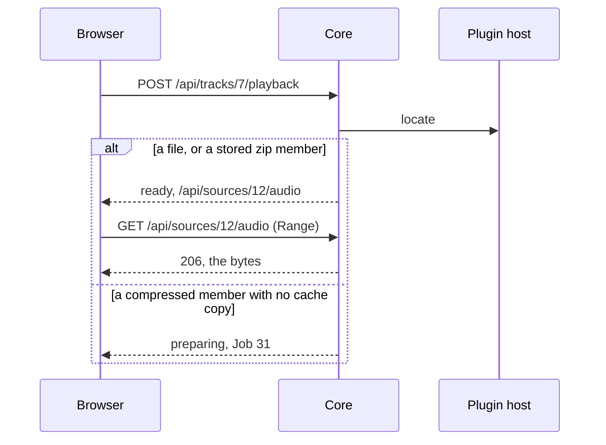
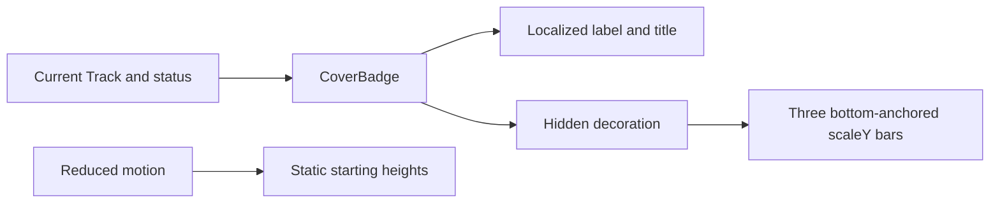
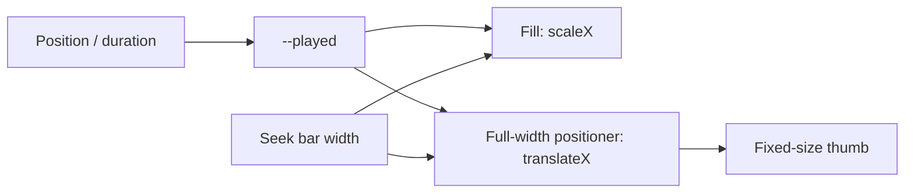
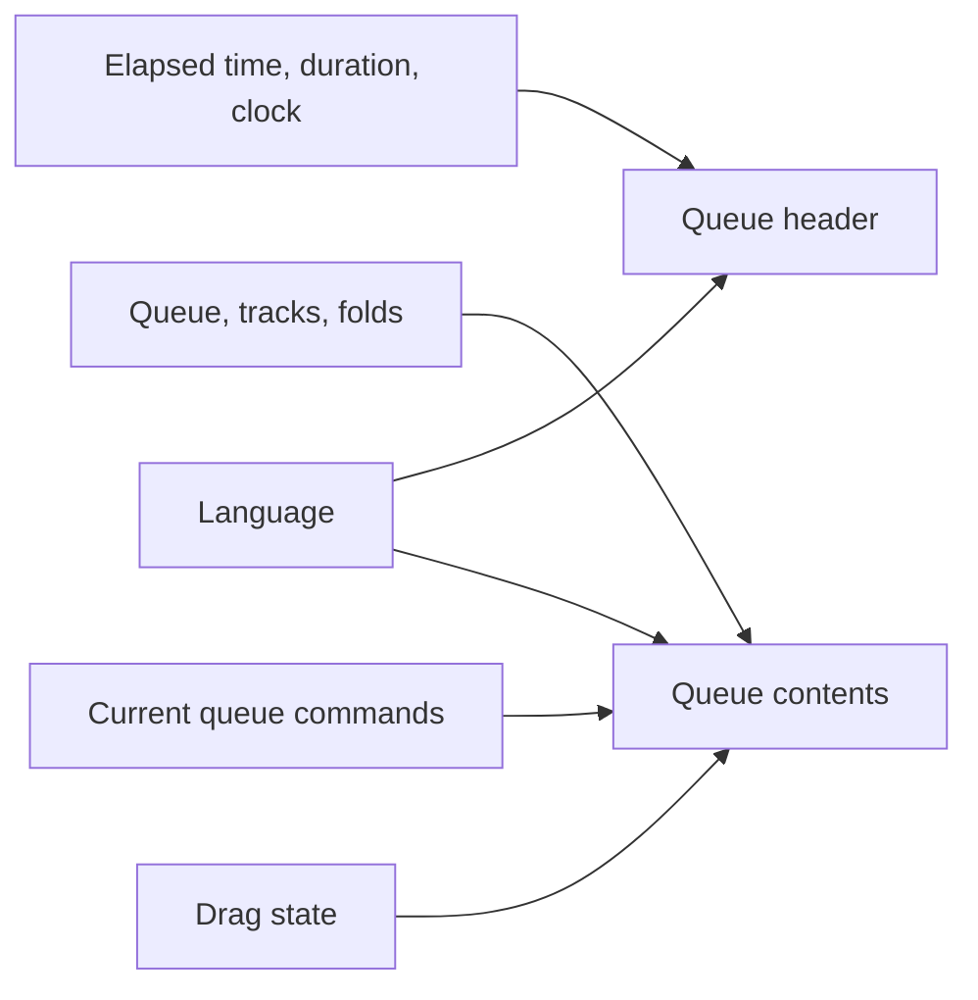

# Playback

> [!NOTE]
> **Status: implemented; the iOS lock-screen check is still to do by hand.** This
> note describes how a browser plays a Track: how the core picks a Source and serves its audio, how a compressed zip member is
> prepared, how plays are recorded, and the bare web client that plays them. What
> playback must do is in [MVP](MVP.md#play); how Libraries locate files is in
> [Libraries](Libraries.md).

## Contents

- [Playing a Track](#playing-a-track)
- [Serving audio](#serving-audio)
- [Preparing a compressed member](#preparing-a-compressed-member)
- [Recording plays](#recording-plays)
- [History](#history)
- [Insights](#insights)
- [Availability in the Track list](#availability-in-the-track-list)
- [The web client](#the-web-client)
- [What the API shows](#what-the-api-shows)
- [Testing](#testing)
- [Left for later steps](#left-for-later-steps)

## Playing a Track

- **The client asks to play a Track, and the core picks its Source.** Of the
  Track's Sources that are *ok*, oldest first, the core answers with the first
  that is **ready**; failing that, it starts preparing the first that can be
  prepared and answers **preparing**; failing that, **unplayable**:
  - **ready**, with the Source's audio URL and media type;
  - **preparing**, with the Job that prepares it;
  - **unplayable**, with why: *missing*, *offline*, *unavailable*, or *can't
    play*, taken from the best Source the Track has.
- **The audio URL names a Source by its id;** the server never takes a path from
  the client.
- **A request never waits on a Job.**

## Serving audio

- **Only an *ok* Source is served.** A Source that is *can't play*, *missing*, or
  *unavailable*, or whose Library is offline, answers 404; one that must be
  prepared first answers 409.
- **A location comes from the plugin and is checked by the core.** For a folder
  Library the path must be inside the root; for a zip Library, whose root is the
  archive, it must be the root itself. The core opens the path once, without
  following a link and without blocking on a FIFO, then checks the open file:
  it must be a regular file, and the slice must lie inside it. Every byte is
  read from that open file, so nothing swapped in after the check is served. A
  location that fails the check answers 502, so a faulty plugin can't make the
  core serve a file outside a Library.
- **Locations are remembered per Source,** with the device, inode, size, and
  modification time of the file they point into. An audio request reuses a
  remembered location while the open file still matches, and asks the plugin
  again when it doesn't. Safari sends many Range requests per seek, and the
  plugin host answers one call at a time, so asking on every request would make
  every device wait on every other. `locate` has a 5-second deadline.
- **A file that is gone is an ordinary answer, not a failure:** `locate` replies
  *missing*, also for an archive that is unreadable or being rewritten, instead of
  raising, so an unplugged drive can't fault the plugin. The audio request
  answers 404; only a scan marks the Source *missing*.
- **The core serves the bytes itself,** from an open file, an offset, and a
  length: the whole file for a Library file or a cache copy, a slice of the
  archive for a stored zip member. Starlette's `FileResponse` handles Range only
  for a whole file, so the core has one small response for both:
  - `Range: bytes=a-b`, `a-`, and `-n`; with several ranges, the first one that
    is satisfiable, and 416 with `Content-Range: bytes */n` when none is, as for
    any range of an empty file;
  - a header that doesn't parse, or isn't in bytes, is ignored and the whole slice
    is served, as RFC 9110 says;
  - a strong `ETag`, a hash of the file's device, inode, size, and modification
    time with the offset and length, so it never shows a path. `If-Range` with a
    matching `ETag` serves the range, and anything else serves the whole slice;
    `If-None-Match` with a matching `ETag` answers 304;
  - `HEAD` answers the headers alone;
  - `Accept-Ranges: bytes`, `Cache-Control: private, no-cache`, and
    `X-Content-Type-Options: nosniff`;
  - reads happen off the event loop, a chunk at a time, and stop when the browser
    goes away.
- **The media type comes from the Source's own path,** never from the archive
  holding it, by a table in the core: `audio/mpeg` for `mp3`, `audio/mp4` for
  `m4a`, `m4b`, and `mp4`, `audio/flac`, `audio/ogg` for `ogg`, `oga`, and
  `opus`, `audio/wav`, `audio/aiff` for `aif`, `aifc`, and `aiff`, and
  `audio/x-ms-wma`. Any other extension is `application/octet-stream`.

## Preparing a compressed member

- **A compressed zip member is copied into the cache once,** and that copy is
  served. The copy is `cache/sources/<source id>-<version>.<extension>` in the
  data folder:
  - the version is a hash of the Source's fingerprint, or of the size and
    modification time its scan recorded when it has none, so a rescan that sees
    the file change also changes the name;
  - the extension is one from the media-type table, so a member's name can't
    shape a path.
- **The copy is made by a Job** of the kind `cache_source`, with the target
  `source:<id>:<version>`, so two devices asking at once start one Job, and a
  Job for an older version is never handed back. Its program:
  1. finishes at once when the copy already exists;
  2. fetches the member into the Job's working folder and checks the copy landed
     there and has the member's length;
  3. flushes it to disk and moves it to its cache path with one rename, so a
     half-written copy is never served.
- **Old copies are removed:** a cache Job's completion removes the Source's other
  copies, and the server removes copies of Sources that are gone, or of versions
  that are no longer current, when it starts.
- **The cache counts toward the storage limit,** and the
  [policy](MVP.md#enforce-the-policy) removes cache copies first; until that
  step, copies stay.

## Recording plays

- **A play is recorded with a client-chosen id:** `PUT /api/plays/{id}` with a
  UUID, the Track, and when it was played, which the server clamps to no later
  than now. The id is the Account's own: sending it again changes nothing, and
  sending it with another Track answers 409.
- **Recording a play** adds a row to the `play` table (Account, id, Track, time)
  and, only when the row is new, raises the Account's play count for the Track
  and sets its last played time, in the same transaction.
- **The client decides when a Track counts as played,** as Last.fm counts a
  scrobble: once it has been *playing* for half its length or four minutes,
  whichever is first, so seeking ahead doesn't count. A Track shorter than 30
  seconds never counts. Each start of a Track gets a new id, so a Track played
  twice counts twice.
- **Plays wait in an outbox** in IndexedDB until the server accepts them, so a
  play made while the server is unreachable is recorded later.

### How long a play was listened to

- **The page measures each play,** by the same position steps that decide it
  counts, so a seek adds nothing. Only a counted play has a time: listening
  to a song skipped before it counts isn't kept.
- **It sends the time with the play,** then again after each further minute of
  listening, and once more when the listen ends: the next song, a pause, or
  the page put away. A later time goes to `PUT /api/plays/{id}/listened`,
  which answers 404 for a play the server doesn't have, so it never counts a
  play again once that play has been forgotten.
- **The server keeps the longest time sent,** at most the Track's length, so a
  time sent again or late changes nothing. Each Track's state adds up the
  measured time and how many plays have one, so all-time totals outlast the
  plays pruned after 30 days. The totals grow by how much longer a play became,
  in statements that take the write lock before they read the play's earlier
  time, so two devices or a retry can't count it twice.
- **Sends run one at a time from the outbox,** which forgets a play only once
  the time the server has is the time kept, so an answer to an older time
  can't drop a newer one. A killed page loses at most a minute of listening.
- **Moving the music to another device hands its play on,** with the time
  listened, and the device taking it goes on with the same play.
- **Plays recorded before pages measured have no time,** and count their
  song's length, as Insights explains.

## History

- **History lists the songs an Account played,** newest first, in a *History*
  tab beside *Up next*. A song is there once it counts as played, by the rule
  above, so a skipped song isn't; a song played twice is there twice. A play a
  device sends late, after being away, sorts by when it was played. Each row
  shows the cover, the title and artist, and when: *just now*, *12 min ago*,
  *9:14 PM* today, *Yesterday 9:14 PM*, *Mon 9:14 PM* within the week, then the
  date. Clicking a row plays that song now and leaves *Up next* as it is; its
  button adds the song to the end of *Up next*. A song that can't play now is
  grayed, as in the Library.
- **It is the Account's, on every device:** it reads the plays the server
  recorded, so a phone's plays show on the computer. It loads when the tab
  opens, when the page is shown again, and after the server accepts a play this
  page sends.
- **It shows the last 50 songs,** or as many as the tab's own *Keeps the last …
  songs* offers: 25, 50, 100, 250, or 500, saved with the Account's preferences.
- **The server keeps plays a while,** since a play's row is also how a play
  sent again is known and counted once. It forgets a play only once it was
  recorded more than 30 days ago and isn't among the Account's newest 500, so
  the table stays small, and every play of the last 30 days is there for
  Insights. Play counts and last played times never change.
- **Clear** hides every play in History so far, on every device, after a second
  click to confirm. The plays stay recorded, so one sent again still counts
  once, until they are forgotten as above. A play another device sends later
  shows, since it wasn't recorded when History was cleared.
- **History isn't cleared when the server restarts or the page reloads:** it is
  the Account's record, as play counts are, and lasts until cleared.
- **Saving preferences keeps what a page leaves out,** so a page that knows only
  the shortcuts doesn't reset History's length, and the other way round.

## Insights

- **Insights shows what an Account listened to most,** in a tab of its own:
  over the last 7 days, the last 30 (the default), or all time. It shows the
  listening time, plays, and songs played; the top artist and album; the ten
  artists and albums listened to longest, each row filled to its share of the
  first; and the ten songs played most, which play as Library rows do.
- **Listening time is what the page measured** of each play, a whole album in
  one file included. A play from before pages measured counts its song's whole
  length; a whole album in one file, or a song of unknown length, then counts
  its play but adds no time, which its length would overstate many times over.
  The page says how many plays counted their whole song, and how many weren't
  timed.
- **Artists and albums group as the Artists and Albums views do:** names
  compared folded, an album under its album artist or its artist. A Track with
  no artist or no album counts in the totals but isn't ranked.
- **Each period asks the server:** the last 7 or 30 days count the Account's
  plays in that time, cleared ones included, since clearing History hides plays
  without undoing them; all time reads each Track's totals. It asks again when
  the page records a play or is shown again.

## Availability in the Track list

- **Each Track in the list says whether it can play now:** *ok* when one of its
  Sources is *ok* in a Library that is online, otherwise the best of *offline*,
  *unavailable*, *missing*, and *can't play*. The client grays out a Track that
  isn't *ok*, or whose media type its browser can't play.
- **Availability is a hint for the list;** the playback request decides.

## The web client

A bare page: enough to sign in and play music on every device. The song table
and the full views are in [Web client](Web%20client.md).

- **Built with what the project already has:** React with `useReducer`,
  `fetch`, and the platform's IndexedDB, with no new dependencies. The page is
  served over plain HTTP on the LAN, which isn't a secure context, so it uses no
  API that needs one: ids come from `crypto.getRandomValues`, not
  `crypto.randomUUID`.
- **The core serves the client:** `npm run build` in `web/` writes it into the
  Python package, in `src/medleyplay/web/client`, which Git ignores and the
  package includes. The server serves it with Starlette's `StaticFiles` at `/`;
  any other path outside `/api` answers the page, and a path under `/api` that
  matches no route answers a JSON 404. The page is served `no-cache` and its
  hashed assets as immutable. Without a built client, `/` says how to build it.
  During development, Vite serves the client and forwards `/api` to the server.
- **Signing in:** the page asks `GET /api/me`; a 401 shows the sign-in form, and
  a server with no Accounts yet shows the first-run form for `POST /api/setup`.
  Any 401 later returns to the sign-in form.
- **The Track list** shows title, artist, album, and duration. Clicking a Track
  queues the whole list and plays from that Track, so the Tracks before it count
  as played: *Previous* reaches them, and *Repeat all* starts over from the
  list's first Track. *Play next* and *Add to queue* put a Track in the queue
  without interrupting.
- **Play and Shuffle** above a view's songs queue every song in it that can play:
  *Play* in the table's order with shuffle off, *Shuffle* at random with shuffle
  on. The queue then holds only that view, so *Repeat all* on an album plays the
  album again; the repeat mode itself is kept.
- **Three orders** play the Library, and each queues its Tracks in *units* a
  shuffle keeps together, in order:

  | Order | Where | Plays | A unit is |
  | --- | --- | --- | --- |
  | The Library's | The Library's Play and Shuffle | Each item in its place, a split file as its songs | A split file's songs |
  | By album | Albums, and the Library's carets | Each album whole, in disc and track order, the albums as listed | An album: its album artist and name, as Albums groups it |
  | By song | The Library's carets | Every song; an album in one file, not split, is left out | None |

  Other views, an artist's or a Playlist's, play their songs as listed, each on
  its own. A unit is the entry's `unit`, such as `file:9`; entries side by side
  with one unit shuffle as one, whether Shuffle queued them, shuffle was turned
  on later, or a Track was clicked while shuffled. A queue saved without units
  shuffles as it did.
- **A song in Up next plays when clicked:** anywhere on its row but its handle
  and *Remove*, or its title pressed, it plays now from its start, as *Next*
  would reach it; the songs before it count as passed. An album's row plays from
  its first song queued.
- **The album playing lists its songs** from its mark beside the title, pointed
  at, focused, or pressed: those played, the one playing and how far, and those
  to come, each led by its heart to favorite it. They close once the mouse leaves
  them, focus leaves them, or Escape is pressed; the seek bar's card of the same
  songs follows the pointer.
- **Up next names an album's songs:** two or more songs of one split file in a
  row show under a row with the file's name and where they start in it, such as
  *3 of 11*. It folds them away, and its *Remove* removes them all; each song
  still moves and goes on its own. The row is worked out from the queue, which
  holds only its entries.
- **In every Up next panel,** one icon expands or collapses every
  album group without changing playback. It appears only when the queue has
  an album group. If any group is collapsed, the icon expands all groups.
  Beside it, the **Clear Up next** icon removes upcoming songs without
  stopping the current song. The controls fit beside the tabs and wrap together
  if there is not enough room.
- **Play modes** are two controls, as in most players: *Shuffle*, on or off,
  and *Repeat*, which cycles through off, all, and one. In order is both off.
  - **Turning shuffle on** puts what plays next in random order. What played and
    the Track playing keep their places, so *Previous* still goes back through
    them. The queue remembers its own order.
  - **Turning shuffle off** puts the queue back in its own order, with the Track
    playing in its own place, and plays what follows it there; an entry heard
    while shuffled may follow it again. A move made while shuffled lasts until
    then.
  - **While shuffled,** clicking a Track plays it, then every other Track of the
    list in random order. *Play next* still plays next, and *Add to queue* still
    adds at the end; each takes the same place in the queue's own order.
  - **Repeat all** plays the first entry again after the last, in the same
    order, shuffled or not. *Next* past the last entry does the same, under
    *Repeat one* too, and turning repeat on for a finished queue starts it over.
  - **Repeat one** starts the Track again when it ends. *Next* and *Previous*
    still move through the queue.
  - **Starting a Track over is a new play,** whether *Repeat one* or *Previous*
    started it.
  - **The Repeat button names its mode,** such as *Repeat: all*, and a status
    message says each change, since a label that changes on a focused button
    isn't always read out. *Shuffle* is a toggle button.
  - **Both modes are saved with the queue.** A queue saved before play modes
    existed restores in order; a saved order that doesn't hold exactly the
    queue's entries is dropped.
- **The queue** lists what plays next; a Track is dragged by its handle into
  another place, with a pointer or a finger, or moved from the keyboard (Space
  picks it up, the arrow keys move it, Space drops it, and a screen reader hears
  each step), and it can be removed, or the queue cleared. Dragging is dnd-kit's
  sortable list. The queue is a pure reducer, so its rules are unit tested apart
  from the page.
- **How long the queue plays** shows under *Up next*, as *12 songs, 48 min*, in
  the words the views use for their length. While it plays on to its end, with
  repeat off, it adds when that is on the clock, with the day once it isn't
  today: *ending around 4:30 PM*, or *ending around Wed 2:12 AM*. A week or more
  away, it gives no time. The words are the client's own, as its other words
  are, with the time from `Intl.DateTimeFormat`. Moment and Day.js were set
  aside, as their *humanize* rounds to one unit (*2 hours* for 1 hr 42 min).
  `Intl.DurationFormat` is the one to take once the client speaks more
  languages than English.
- **A sleep timer** sits in the *Up next* header, a moon offering *15 minutes*,
  *30 minutes*, *45 minutes*, *1 hour*, or *2 hours*. Once set, the moon is filled.
  Its tooltip and menu show the time left against the chosen duration, as
  *28 min left of 30 min*. The menu offers *Turn off the timer*. When the time
  is up it pauses whatever plays; nothing playing, nothing changes. It lives
  in the page, so reloading turns it off, and a browser may run a hidden page's
  timer up to a minute late.
- **The look** is Pico's jade theme under the client's own palette, with
  Phosphor's icons in the weight each control's prominence calls for: filled for
  play and pause, regular for the rest, light for a row's actions. The page
  follows the system's light or dark scheme unless a browser chooses one in the
  header's theme switch, which it remembers. On a touch screen, which can't
  point at a row, a row's actions and the seek bar's thumb always show.
- **The player** shows the Track, shuffle, previous, play and pause, next,
  repeat, a seek bar, the volume, and the time.
  - **Under the title, the song's artists and its album are links** to their
    pages (*周杰伦, 费玉清 — 叶惠美*), each artist to its own page by its id, as
    Now Playing's names are. A file that is the album itself leaves the album out.
  - **One persistent `<audio>` element;** the next Track swaps its `src`, so
    autoplay keeps working on iOS after the first tap.
  - **The next Track is asked for ahead of time,** once the current one loads,
    and again whenever what plays next changes, so the `ended` event only swaps
    `src` and plays: iOS may suspend a locked page during a network round trip.
    Asking ahead also starts preparing a compressed next Track.
  - **Whole files advance on the `ended` event.** A song inside a split file
    advances at its own end. If playback is already inside the next contiguous
    song by the time the player handles the boundary, it keeps that
    position instead of repeating the opening, even if it paused to wait for
    the playback answer. Pressing **Next** still starts the queued song from its
    beginning.
  - **The seek bar is the client's own slider,** not a range input, whose
    thumb width shifts where a click lands. The time comes from where the pointer
    is on the bar. Hovering shows that time over the pointer; a click seeks there
    at once; a drag follows the pointer, with the Track playing on undisturbed,
    and seeks once where it is let go. The arrow keys move five seconds, Page Up
    and Page Down a tenth of the Track, and Home and End to either end.
  - **The bar stays where it was sent** until the audio reports a position
    within a second of it, or for two seconds at most, so it never jumps back
    before moving on. Between the audio's few position updates a second the bar
    glides, unless the system asks for reduced motion.
  - **While an album of songs plays, the bar spans the album,** in the player and
    in Now Playing alike, and the time beside it is the album's. It is split into
    one segment a song, each filled as far as it has played. The segment under
    the pointer lights up, the tip names its song, and a card of the album's
    songs shows over the pointer with the song under it ringed. It stays a moment
    after the pointer leaves the bar, and a strip spans the gap, so the pointer
    can move up onto it; there it holds still, and a song chosen on it plays.
    Pressing on the card never seeks. Its songs are for the pointer: the album's
    mark lists the same songs for the keyboard, so Tab passes the card by.
  - **The volume** steps a tenth with each of its buttons, and its bar sets it
    once let go. Each browser keeps its own. On iOS, where only the device sets
    the volume, the control doesn't show.
  - **Previous** restarts the Track after its first three seconds, and goes to
    the previous Track before that.
  - **A Track that is preparing** shows *Preparing*; the client polls its Job,
    every second and then every three, stops at any final state, and asks to play
    again when it succeeds, at most three times. One that fails, is cancelled, or
    can't play shows why, and *Next* skips it.
  - **An audio error** asks `GET /api/me`, so an expired session returns to the
    sign-in form.
- **Media Session:** the Track's metadata; the play, pause, previous, next, and
  seek-to actions, without seek-backward and seek-forward, which iOS would show
  in place of previous and next; `playbackState`; and `setPositionState` when the
  position jumps or the Track loads, only once the duration is known. *Play* and
  *pause* each ask for a state, not a change, since the system may send *pause*
  once per earbud taken out.
- **A change of audio devices pauses** (`devicechange`), so taking out earbuds or
  unplugging headphones doesn't play on through the speakers. Any device counts,
  a microphone or a camera too, since telling outputs apart needs microphone
  permission. A plain-HTTP page has no devices to follow, and Safari reports them
  only to a page allowed the microphone; there the system's *pause* does the work.
- **The queue and the current position are saved in IndexedDB,** best effort. A
  restored position is applied, paused, once the Track's metadata loads; when the
  browser can't save, or has cleared it, the page starts with an empty queue.

### Playing-badge rendering

> [!NOTE]
> **Implemented.** Keep the current Track's animated badge while avoiding
> repeated painting of its bars.

The Playing badge is a decoration inside `TrackTable`'s `CoverBadge`.
Three bottom-anchored elements change height through `scaleY`, rather than
repainting three gradient backgrounds.
The badge's size, color, rhythm, label, and place over the cover stay the same.
The current Track keeps its badge when paused, matching the existing behavior.
Changing that behavior, other animations, and first-load work are outside scope.

#### Badge positioning and motion

`CoverBadge` keeps its existing inputs and status precedence. A lookup or
download status replaces the Playing badge; otherwise the current Track has
the localized Playing label and title. Three decorative spans stay inside
the existing `aria-hidden` bars element. No state, animation clock, public API,
or dependency is added.

The `bars` element keeps its inline size and becomes the positioning reference.
Each child is 22% wide and fills its height before transformation. Horizontal
positions are 0%, 39%, and 78%, matching the gradient alignment. Each child
scales from the bottom and uses its own `@keyframes` rule:

| Cycle position | Left bar | Middle bar | Right bar |
| --- | ---: | ---: | ---: |
| Start | 60% | 100% | 40% |
| Halfway | 100% | 35% | 80% |
| End | 40% | 75% | 100% |

Motion takes 1.1 seconds, with `ease-in-out` between the listed cycle positions, repeating
forever in alternating directions. Reduced motion disables all three
animations and keeps the starting heights. Resizing and theme changes use
the same relative sizes and accent color; no permanent `will-change` hint
is added.

#### Badge acceptance

- [x] Preserve the badge's bounding box, color, horizontal alignment, and
      animation heights across the complete forward and reverse cycle.
- [x] Animate transforms, not layout or background properties; keep the
      original duration, easing, direction, and reduced-motion appearance.
- [x] Preserve current-track changes, paused-track behavior, status
      precedence, localized labels, and accessible hiding of the decoration.
- [x] Compare phase-matched pixels at desktop and phone widths in light
      and dark themes, including reduced motion.
- [x] Compare separate compiled baseline and candidate builds in seven
      alternating headless pairs per playback state. Keep the badge moving;
      record actual audio progress, renderer work, and `keydown` timing.
- [x] Obtain independent implementation review and reconcile the measured
      result here without claiming physical display latency, whole-machine
      CPU usage, or a first-load improvement.

Existing Track-table unit tests own status precedence and current-track
selection. Browser tests check CSS motion, geometry, and reduced motion.
Timing measurements stay outside CI.

#### Badge measurements

Separate production builds were compared in headless Chrome with a
1,906-Track Library, one visible Playing badge, and two queued Tracks.
Seven alternating pairs per playback state ran on a busy shared Mac.
Audio advanced in every playing sample and stayed paused in every paused
sample; the badge continued animating in both states.

| Playback state | Baseline renderer work | Transform renderer work | Median paired reduction |
| --- | ---: | ---: | ---: |
| Playing | 595 ms/s | 303 ms/s | 47.5% |
| Paused | 279 ms/s | 7.5 ms/s | 97.4% |

The work columns are medians of Chrome's renderer-task duration per second.
The reduction column is the median of each pair's percentage reduction,
not a ratio of those medians. All playing pairs improved by 44–56%; all
paused pairs improved by 96–98%. In separate three-second playing traces,
main-thread Paint events fell from 297 to 6 while Layout events stayed at 3.

Keyboard-to-next-paint medians were 120 → 104 ms while playing and
96 → 104 ms while paused. These mixed results do not establish an input-latency
improvement. The measurements describe this browser workload, not physical
display latency, whole-machine CPU use, field responsiveness, or first load.

Phase-matched captures cover the forward and reverse cycle and reduced motion,
at desktop and phone widths in both themes. The outer box and colors match;
bar geometry differs by at most 0.016 CSS pixels. The crops are not
pixel-identical: transformed elements rasterize fractional edges differently
from gradients. Differing pixels stay within 1.1 CSS pixels of bar boundaries
at a device scale of 1.

### Seek-thumb rendering

> [!NOTE]
> **Implemented.** Keep the seek thumb's motion and interactions while
> avoiding a layout-dependent transition in browsers that support the clipping rules.

The fill and thumb move through transforms for 260 ms after each playback
update. The thumb's motion continues while it is transparent, so avoiding
layout work matters even when nobody is pointing at the bar.

#### Positioning boundary

`SeekBar`'s JavaScript state and event handling are unchanged. A decorative
`seek-thumb-clip` span fills the seek bar and contains a full-width,
zero-height `seek-thumb-position` span around the existing fixed-size thumb.
The positioning box translates by
`calc(var(--played) * 100%)`; its own width is the seek bar's width.
The circle retains its color, shadow, size, horizontal centering margin,
opacity, and accessible hiding.

The positioning box is at the bar's vertical center; the circle is at its origin.
The stationary clipping span uses `overflow: clip` and a `3rem` clip margin
to bound scrollable overflow while leaving room for the circle and its shadow.
Only the decorative thumb is inside it; tooltips and previews remain outside.
Percentages preserve alignment when the bar resizes, without JavaScript
width measurement or containment on the interactive slider.
Browser geometry checks cover 0%, 50%, and 100% at desktop and phone widths,
including the first frame after resizing. Scroll extents match each layout's
existing extent throughout that range; this does not repair pre-existing
overflow in Now Playing.

The positioning box has a 260 ms linear `transform` transition; the circle
keeps its 120 ms opacity transition. Movement is immediate while held and
when reduced motion is requested, matching the fill. No permanent
`will-change` hint is needed.
An `@supports` guard enables this path only when `overflow: clip` and
`overflow-clip-margin: 3rem` are supported. Otherwise, both wrappers use
`display: contents` and the circle keeps its `left` transition. No performance
gain is claimed for that fallback.

The slider, pointer capture, keyboard seeking, sent-position hold, segmented
fills, tooltips, previews, playback state, and server protocol remain unchanged.
The playing bars, note/record animation, Artists rendering, and startup are
outside this component.

#### Seek-rendering evidence

A disposable Library contains 1,906 tracks, 890 album cards, and two queued
entries, with real local silent audio. Headless Chrome at 1280 by 800 compares
the compiled baseline and candidate while Albums is open and playback
continues. Seven pairs alternate build order for each condition: the thumb
hidden, and the thumb visible under the pointer. No household data or outside
site is used.

Each sample measures renderer task, scripting, and layout duration over about
three seconds, divided by recorded elapsed time. Three Enter presses on
**Volume down** then check both actual audio volume and its displayed value.
Event Timing measures each `keydown` to its next browser paint; each sample
contributes the median of its three interactions.

| Thumb | Measure | Baseline median | Candidate median | Median paired saving |
| --- | --- | ---: | ---: | ---: |
| Hidden | Renderer task time per second | 494 ms | 178 ms | 329 ms (64.2%) |
| Visible | Renderer task time per second | 526 ms | 170 ms | 355 ms (67.5%) |
| Hidden | Layout time per second | 8.78 ms | 0.37 ms | 8.49 ms (96.4%) |
| Visible | Layout time per second | 9.14 ms | 0.29 ms | 8.85 ms (96.7%) |
| Hidden | Keydown to next paint | 48 ms | 48 ms | 8 ms (12.5%) |
| Visible | Keydown to next paint | 64 ms | 48 ms | 16 ms (28.6%) |

The before/after columns are medians across samples; paired savings and
percentages are medians of each pair's differences. Task and layout time
improve in every pair. Scripting stays similar: hidden-thumb medians are
66.8 and 67.6 ms per second; visible-thumb medians are 63.7 and 62.4 ms.
Next-paint results are less consistent. Hidden-thumb timing improves in four
pairs, ties in two, and is 8 ms slower in one; visible-thumb timing improves
in six and is 16 ms slower in one. This supports retaining the renderer
saving, not a universal latency improvement.

All final samples retain moving audio and a moving thumb. The measured windows
last 3.002–3.066 seconds and contain 11–12 progress events in either build.
Audio readings around those windows advance 3.051–3.192 seconds. All key events
have an Event Timing entry; none is replaced with zero or an assumed
below-threshold value. The final collection has no failed or replaced trials.
Earlier incomplete diagnostic collections are not part of these results.

Separate three-second traces with the thumb visible show 177 layout events
and 352 paint events in the baseline, versus 3 and 6 in the candidate.
These traces support the rendering explanation; they are not additional
paired samples or proof of a particular GPU compositing path.

The measurements run on a **busy, shared Mac**, without artificial CPU
throttling; the one-minute load average ranges from 16.9 to 28.6.
Headless paint timing is a laboratory measurement, not physical display
latency, a whole keyboard interaction, or field INP. Renderer task time is
not whole-machine CPU usage. No first-load improvement is claimed.

#### Acceptance

- [x] Add browser regression coverage that distinguishes transform-based
      movement from the baseline `left` transition.
- [x] Match thumb center to bar position at the endpoints and intermediate
      values, including narrow widths and the first frame after resizing,
      both during a transition and after it settles.
- [x] Preserve the 260 ms linear interpolation and alignment with the fill;
      held and reduced-motion updates must be immediate.
- [x] Preserve clicks, drags, pointer cancellation, keyboard seeking, unknown
      duration, and the sent-position hold until the player responds.
- [x] Check segmented album bars and both the regular and Now Playing layouts.
- [x] Keep endpoint hit targets, hover/focus visibility, shadow,
      tooltip/preview layering, language, and slider accessibility without
      adding horizontal scrolling to the document or modal container.
      Paired light/dark image crops preserve the shadow and endpoints;
      desktop modal edges differ by less than a pixel in rasterization.
- [x] Compare scroll extents through the full range against the layout's
      existing extent, including a modal with pre-existing overflow.
      Verify the clipping-disabled fallback and shadow/endpoint hit areas.
- [x] Compare real baseline and candidate in seven alternating headless
      pairs during playback, with the thumb hidden and visible, and record
      renderer task/layout time, actual audio progress, and time from `keydown`
      to next paint.
- [x] Verify that movement remains active; do not claim a saving from hiding
      or stopping the indicator. Inspect compositing or rendering traces.
- [x] Obtain independent implementation and retention review, then reconcile
      this record with the actual result. No timing thresholds enter unit CI.

The existing seek-bar unit and browser suites own interaction semantics.
Use browser geometry and animation checks for the new positioning boundary.
No dependency, animation clock, or public API is added.

### Queue rendering during playback

> [!NOTE]
> **Implemented.** Keep the queue header current without
> rendering every unchanged queued item on each progress update.

`QueuePanel` reads elapsed playback time to show when the queue ends.
Its `QueueContents` child reuses unchanged draggable contents through
React's `memo`. Sortable state, kind marks, translated labels, and controls
do not need rebuilding just because the audio clock advances.

#### Queue-rendering evidence

A disposable catalog contains 1,906 tracks backed by local silent WAV files.
Only the local-file plugin is enabled; no outside site or household data
is used. Foreground Chrome at 1280 by 800 compares the complete baseline
and candidate with Library and Up next visible during playback. Seven
pairs alternate which build runs first for each queue size.

Scripting is measured over three-second windows, divided by the recorded
elapsed time; actual windows range from 3.001 to 3.034 seconds. Each sample
then measures three Enter presses on **Volume down**, checking the audio
volume and displayed value. The browser's Event Timing measures each
`keydown` through its next paint. Each sample contributes the median of its
three interactions.

| Queue | Measure | Baseline median | Candidate median | Median paired saving |
| --- | --- | ---: | ---: | ---: |
| 1,905 entries | Scripting per elapsed second | 963 ms | 149 ms | 815 ms (84.6%) |
| 1,905 entries | Keydown to next paint | 1,112 ms | 168 ms | 952 ms (87.6%) |
| 2 entries | Scripting per elapsed second | 139 ms | 127 ms | 7 ms (5.6%) |
| 2 entries | Keydown to next paint | 88 ms | 80 ms | 8 ms later |

The before/after columns are medians across samples; paired savings and
percentages are medians of the differences within each pair. Both
long-queue measures improve in every pair. All expected rows remain in the
DOM, audio continues, and each input occurs in a focused, visible page.
Each long-queue window delivers 2–6 progress events with the baseline and
10–11 with the candidate. The saving does not come from delivering fewer
updates.

These are measurements on a **busy, shared Mac**, without artificial CPU
throttling. Its one-minute load average ranges from 10.9 to 71.0 during
the long-queue pairs. Absolute times are not a quiet-machine estimate,
a first-load improvement, or field INP. Scripting time is a renderer
measurement, not whole-machine CPU utilization.

Short-queue latency is inconclusive: four pairs are slower, two tie, and
one improves. The largest paired delay is 56 ms. A secondary DOM-change
and following-frame proxy stays near 49 ms; it is not a paint timestamp.
Do not claim a short-queue latency improvement or proof of no regression.
The repeatable long-queue gain supports retaining the change.

#### Queue-rendering boundary

The clock-dependent header is separate from queue contents wrapped in
`memo`. Every expanded row stays in the DOM;
folded groups retain their current behavior. This component does not
virtualize or truncate the list.

| Part | Responsibility |
| --- | --- |
| `QueuePanel` | Tabs, sleep timer, clear and fold-all controls, duration and ending-time display. |
| `QueueContents` | Sortable context, rows, group controls, and drag announcements. |
| Local and remote player hooks | Queue command callbacks whose identities stay stable across elapsed-time updates, with current behavior when their real dependencies change. |

Queue-derived arrays are reused while their queue, track map, and folded-file
set are unchanged. The cache uses the queue snapshot, not just its entries array:
advancing the current entry changes Up next even when entries are reused.
The contents receive only the data and commands they need, not the whole
changing `Player` object. The header responds to elapsed time, duration,
repeat mode, playback state, the clock, and formatting locale. An unknown
duration remains unknown; no cached total may invent an ending time.
The total duration itself is cached, so clock updates do not rescan every
queued entry.

The required commands, `playAt`, `move`, and `remove`, pass through as stable
references without fresh wrappers. Local seeking reads the current audio
and segment refs; `playAt` depends on the current entry key and seek callback.
Remote commands keep their delivery order and error reporting, and new
commands bind to the current sign-out callback. Ordinary callback
dependencies keep these bindings current; there is no comparator that
ignores functions or mutable callback cache.

The contents update for queue edits, changed track metadata,
folding, language changes, drag state, and a changed announcement
container. The contents read language themselves, so `memo` cannot freeze
translated controls or drag messages. The regular panel and the Now Playing
panel keep separate folded state. Modal announcements belong inside the
dialog, not necessarily inside its queue section.

New remote reports may replace the queue object. That invalidates the
cache; there is no deep comparison or remote protocol change. Not every
remote report becomes cheap.

#### Queue-rendering acceptance

- [x] Command identities remain stable across elapsed-time-only updates,
      preserving seeking, moving, removing, and command order.
- [x] Commands use the current entry, queue, audio
      segment, authentication callback, and selected local or remote player.
- [x] Queue a remote command behind a pending one, change the sign-out
      callback, then send another command. A rejection must not stop later
      delivery, and a new 401 must use the new callback binding.
- [x] Preserve queue changes, duplicates, missing tracks, unknown durations,
      grouping, folding, and the existing row/control click behavior.
- [x] Keep duration, ending time, sleep timer, and playback controls live.
- [x] Exercise pointer and keyboard dragging during playback, including
      removal, queue changes, and resizing, in regular and Now Playing panels.
- [x] Drop an entry past a folded album using the keyboard. Its destination
      and translated announcement must use the full Up next order, not
      just the visible rows.
- [x] Verify metadata, lyrics availability, and English/Simplified Chinese
      changes reach the list and announcements while playback continues.
- [x] Compare actual baseline and candidate with the same short and long
      queues, real silent playback, and recorded sample durations/events.
      Confirm all expected entries remain present.
- [x] Measure foreground interaction-to-next-paint as well as scripting.
      Keep timing comparisons out of required unit-test thresholds.
- [x] Obtain independent implementation review and retain the change only
      when the candidate demonstrates repeatable benefit.

Hook and component tests check command and data correctness. Browser tests
cover dragging, folding, resizing, removal, and a live language change in
the mounted modal. Local benchmarks measure rendering cost without counting
private render calls.

Queue virtualization, initial queue-mount cost, gallery rendering changes,
backend changes, and new dependencies are outside this component.

## What the API shows

| Route | Who | Does |
| --- | --- | --- |
| `POST /api/tracks/{id}/playback` | Signed in | Picks a Source; answers ready, preparing, or unplayable |
| `GET`, `HEAD /api/sources/{id}/audio` | Signed in | Serves a Source's audio, with Range; 404 when it can't play, 409 when it must be prepared first |
| `PUT /api/plays/{id}` | Signed in | Records a play of a Track under a client UUID |
| `GET /api/plays?limit=` | Signed in | The Account's History: up to `limit` (at most 500) of its plays, newest first |
| `DELETE /api/plays` | Signed in | Clears the Account's History |
| `PUT /api/plays/{id}/listened` | Signed in | Notes how long a recorded play was listened to; the longest time stays |
| `GET /api/plays/counts?days=` | Signed in | How often and how long the Account played each Track in the last 7 or 30 days, cleared plays included, or all time with no `days` |
| `GET /api/tracks` | Signed in | Each Track now also has its `availability` |

## Testing

- **Range:** unit tests and a Hypothesis property: for any slice and any
  satisfiable range, the body is exactly those bytes of the slice. httpx tests
  for `bytes=0-1`, open-ended, suffix, unsatisfiable (416), several ranges,
  malformed headers, `HEAD`, `ETag` with `If-Range` and `If-None-Match`, and the
  media types, including a stored zip member's.
- **Locations:** a fake plugin whose location is outside the Library, past the
  file's end, a link, or not a regular file is refused; a missing file answers
  404; a file changed after it was located is located again.
- **Preparing:** a compressed member prepares through a real Job process, then
  plays from the cache; two requests at once start one Job; a Source with a
  ready Source and a compressed one plays the ready one.
- **Plays:** recording twice counts once; the same id with another Track is
  refused; another Account's ids are its own. History lists plays newest
  first; clearing hides them and still counts a play sent again once; a play is
  forgotten only past 30 days and the newest 500. Play counts over 7 or 30 days
  are the Account's own, keep cleared plays, and fit in the 30 days plays are
  kept.
- **Client:** Vitest for the queue reducer, the play-count rule, and the
  components; Playwright against the real server, with a Library of generated
  WAV files, for signing in, playing, seeking, and moving through the queue. A
  test of the built package checks it holds the client.
- **By hand on iOS:** the lock screen, background playback, and moving to the
  next Track while locked.

## Left for later steps

- **Bilibili Downloads** play through the same `playback` request, and play
  whatever their Source's state; see [Bilibili](Bilibili.md#playing-a-download).
- **The storage limit** and removing cache copies, in step 6.
- **The full views** are in [Web client](Web%20client.md); artwork and SSE
  progress, in step 7.
